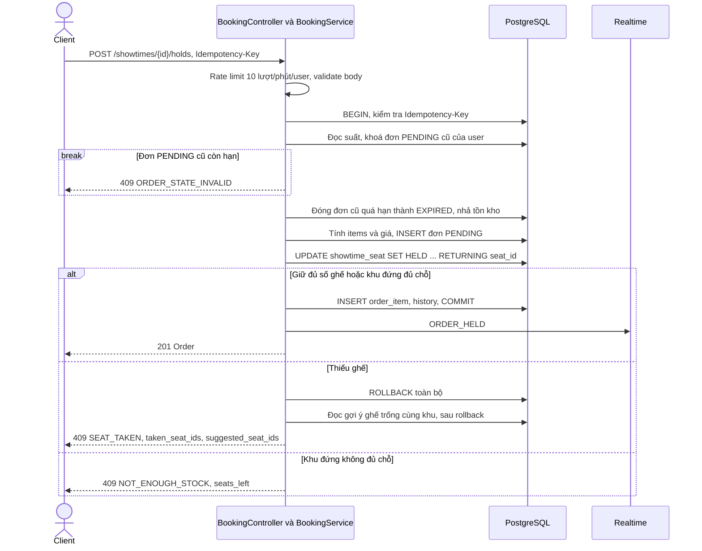

# Giữ chỗ và đơn hàng trong Vingo

Module `booking` quản lý vòng đời đơn từ lúc giữ ghế đến lúc chốt bán. Nguồn sự thật là PostgreSQL. Ghế được giữ bằng một câu `UPDATE` có điều kiện, không dùng Redis. Việc tạo thanh toán và chốt bán nằm ở module `payment`, module này chỉ cung cấp các hàm để `payment` gọi trong cùng transaction. [Contract OpenAPI](../contracts/vingo-openapi.yaml) · [Migration booking](../src/main/resources/db/migration/V20261110_0930__booking_init.sql)

## 1. Phạm vi triển khai

- `POST /api/v1/showtimes/{id}/holds` tạo đơn `PENDING` và giữ toàn bộ ghế hoặc số chỗ khu đứng. Hoặc giữ được tất cả, hoặc không giữ gì.
- `GET /api/v1/orders` và `GET /api/v1/orders/{id}` cho buyer xem đơn của mình. `adminops` dùng thêm các hàm tra cứu đơn cho admin.
- `POST /api/v1/orders/{id}/cancel` huỷ đơn `PENDING` và nhả tồn kho.
- Job `expire_holds` chuyển đơn `PENDING` quá hạn sang `EXPIRED` và nhả tồn kho.
- `markSold`, `markNeedsReview` và `resolveReview` là hàm nội bộ cho `payment` và `adminops`, chạy chung transaction của người gọi.
- Không có hoàn tiền tự động và không có đổi ghế. Muốn đổi ghế thì huỷ đơn rồi giữ lại.

## 2. Sequence giữ ghế



Controller và service nằm cùng một lifeline vì mọi bước DB chạy trong một transaction. Gợi ý ghế được đọc **sau** rollback để không giữ lock và thấy cả ghế vừa nhả.

## 3. Trách nhiệm của từng lớp

| Thành phần | Trách nhiệm |
|---|---|
| [`BookingController`](../src/main/java/vingo/booking/web/BookingController.java) | `implements BookingApi` sinh từ contract. Giới hạn tần suất giữ ghế rồi gọi service. |
| [`BookingService`](../src/main/java/vingo/booking/BookingService.java) | API công khai của module. Mở transaction, gọi idempotency, kiểm tra quy tắc nghiệp vụ, phát sự kiện realtime. |
| [`BookingRepository`](../src/main/java/vingo/booking/internal/BookingRepository.java) | SQL viết tay bằng `JdbcClient` trên `orders`, `showtime_seat`, `showtime_zone_stock`, `order_item` và bảng history. Không dùng JPA. |
| [`OrderReader`](../src/main/java/vingo/booking/internal/OrderReader.java) | Dựng model `Order` trả về, kể cả trạng thái hiển thị theo thời điểm đọc. |
| [`ExpireHoldsJob`](../src/main/java/vingo/booking/internal/ExpireHoldsJob.java) | Profile `worker`, mỗi 5 giây, ShedLock `expire_holds`, tối đa 50 batch × 100 đơn mỗi lượt. |
| `SeatHoldConflict` và `SeatTakenException` | Báo thiếu ghế để rollback, rồi đổi thành lỗi 409 kèm gợi ý. |
| `OrderCancelled`, `OrderForPayment`, `SaleOutcome`, `ReviewReason` | Kiểu dữ liệu chung để `payment` và `adminops` làm việc với `booking` mà không chạm vào `internal`. |

Luồng đi theo **controller → service → repository → PostgreSQL**. Module khác chỉ gọi class ở gốc package `vingo.booking`.

## 4. Vì sao chọn cách này?

### Giữ ghế bằng một câu UPDATE

- **Ghế trống** là `AVAILABLE`, hoặc `HELD` nhưng `held_until < now`. Ghế hết hạn giữ không cần job dọn mới bán lại được.
- **`UPDATE ... WHERE (điều kiện trống) RETURNING seat_id`** chọn và khoá ghế theo `ORDER BY seat_id FOR UPDATE`. Hai request tranh cùng ghế chỉ một bên giữ được. Số dòng trả về nhỏ hơn số ghế yêu cầu thì ném `SeatHoldConflict` và rollback cả đơn.
- **Khu đứng** dùng `UPDATE showtime_zone_stock SET held = held + :n WHERE capacity - sold - held >= :n`. Update không khớp dòng nào thì trả `NOT_ENOUGH_STOCK` kèm số chỗ còn lại.
- **Ghế đôi** tự thêm ghế cặp trước khi tính số vé và giá. Số vé tính cả ghế được thêm.
- **Hạn giữ** lấy từ `vingo.hold.ttl`, mặc định `PT10M`.
- **Một đơn `PENDING` cho mỗi user và suất**: service kiểm tra, unique index `orders_one_pending_per_showtime_uk` chặn hai request song song.
- **Thứ tự khoá** luôn là đơn trước, tồn kho sau, để hold, cancel, IPN và job hết hạn không khoá chéo nhau.

### Idempotency

Hold nhận `Idempotency-Key` bắt buộc. Phạm vi key là `(user, endpoint kèm showtime_id)`. Cùng key và cùng body trong 24 giờ trả lại kết quả cũ. Cùng key nhưng khác body trả `409 IDEMPOTENCY_CONFLICT`. Nhờ vậy client retry khi mạng lỗi không tạo thêm đơn.

### Vòng đời đơn

```
PENDING ──► PAID                 (IPN hoặc querydr thành công, còn đủ tồn kho)
PENDING ──► CANCELLED            (buyer huỷ)
PENDING ──► EXPIRED              (job hoặc hold mới phát hiện quá hạn)
PENDING ──► NEEDS_REVIEW         (tiền về nhưng thiếu tồn kho)
EXPIRED, CANCELLED ──► NEEDS_REVIEW   (tiền về muộn)
NEEDS_REVIEW ──► PAID | REFUNDED      (admin xử lý)
```

| Hàm | Ai gọi | Hành vi |
|---|---|---|
| `cancelOrder` | Buyer | Khoá đơn, kiểm chủ sở hữu, chỉ nhận `PENDING` (kể cả quá hạn), nhả tồn kho, ghi history, phát `OrderCancelled`. |
| `expireOverdueHolds` | `ExpireHoldsJob` | Lấy đơn quá hạn bằng `FOR UPDATE SKIP LOCKED`, nhả tồn kho, chuyển `EXPIRED`, phát `ORDER_EXPIRED`. Chạy lại không làm gì thêm. |
| `markSold` | `payment` | Chỉ nhận `PENDING`. Khoá và kiểm đủ ghế lẫn khu đứng trước khi bán. Thiếu thì chuyển `NEEDS_REVIEW` với lý do `PAID_AFTER_EXPIRY` và không phát vé. Đủ thì bán, chuyển `PAID`, phát `ORDER_PAID`. |
| `markNeedsReview` | `payment` | Nhận `PENDING`, `EXPIRED`, `CANCELLED`. Với `PENDING` thì nhả tồn kho còn giữ. |
| `resolveReview` | `adminops` | `ISSUE_TICKETS` lấy lại đúng ghế cũ rồi chuyển `PAID`. Nếu không lấy được thì trả `SEAT_TAKEN` hoặc `NOT_ENOUGH_STOCK`. Hành động còn lại chuyển `REFUNDED`. |

Các hàm `MANDATORY` (`markSold`, `markNeedsReview`, `lockOrderForPayment`, `orderLines`, `resolveReview`) báo lỗi nếu gọi ngoài transaction. Đơn `PENDING` quá hạn vẫn bán được nếu còn đủ tồn kho. Chỉ IPN hoặc querydr được chốt bán, trang return không được.

## 5. API và mã lỗi

| API | Quyền | Kết quả |
|---|---|---|
| `POST /api/v1/showtimes/{id}/holds` | Buyer | `201` với `Order`. `400`, `404`, `409`, `422`, `429` như bảng dưới. |
| `GET /api/v1/orders` | Buyer | `200` với `data` và `next_cursor`. Lọc `status`, phân trang `cursor` và `limit` 1–100, mặc định 20, mới nhất trước. |
| `GET /api/v1/orders/{id}` | Chủ đơn | `200` với `Order`. `404` nếu không có đơn hoặc không thuộc người gọi. |
| `POST /api/v1/orders/{id}/cancel` | Chủ đơn | `200` với đơn `CANCELLED`. `409 ORDER_STATE_INVALID` nếu đơn không còn `PENDING`. |

| HTTP | code | Khi nào |
|---|---|---|
| 400 | `VALIDATION_ERROR` | Body sai (vừa gửi `seat_ids` vừa gửi `zone_id`, quá 20 ghế, `quantity` ngoài 1–20), ghế không thuộc suất, cursor sai. |
| 404 | `NOT_FOUND` | Suất không tồn tại hoặc `DRAFT`. |
| 409 | `SEAT_TAKEN` | Ghế vừa bị giữ hoặc bán. Kèm `taken_seat_ids` và `suggested_seat_ids`. |
| 409 | `NOT_ENOUGH_STOCK` | Khu đứng thiếu chỗ. Kèm `seats_left`. |
| 409 | `SHOWTIME_NOT_ON_SALE` | Suất chưa mở, đã đóng bán, hoặc khu chưa có giá. |
| 409 | `ORDER_STATE_INVALID` | Đã có đơn `PENDING` còn hạn cho suất này, hoặc huỷ đơn không còn `PENDING`. |
| 409 | `IDEMPOTENCY_CONFLICT` | Trùng `Idempotency-Key` nhưng khác body. |
| 422 | `MAX_TICKETS_EXCEEDED` | Vượt `max_tickets_per_order`, tính cả ghế cặp. |
| 429 | `RATE_LIMITED` | Quá 10 lượt giữ ghế mỗi phút cho một user. |

Mọi thay đổi trạng thái đều ghi history, log INFO kèm `order_id` và `user_id`, và phát sự kiện SSE: `order.held`, `order.paid`, `order.expired`, `order.needs_review`.

## 6. Kiểm thử

```powershell
.\mvnw.cmd "-Dtest=HoldSeatsTest" test
.\mvnw.cmd "-Dtest=HoldSeatsConcurrencyTest" test
.\mvnw.cmd "-Dtest=ExpireHoldsTest" test
.\mvnw.cmd "-Dtest=OrdersTest" test
.\mvnw.cmd clean verify
```

| Test | Kiểm tra |
|---|---|
| `HoldSeatsTest` | Giữ ghế thành công và từng nhánh lỗi của hold. |
| `HoldSeatsConcurrencyTest` | Nhiều luồng cùng giữ một ghế, đúng một luồng thành công. |
| `HoldRateLimitTest` | Giới hạn 10 lượt mỗi phút. |
| `SeatTakenExceptionTest` | Nội dung lỗi `SEAT_TAKEN` và gợi ý ghế. |
| `ExpireHoldsTest`, `ExpireHoldsJobTest`, `ExpireHoldsWorkerTest` | Hết hạn, chạy lại an toàn, job theo batch, bỏ qua đơn đang bị khoá. |
| `OrdersTest` | Xem, liệt kê, phân trang, huỷ và kiểm quyền sở hữu. |
| `BookingPaymentApiTest`, `BookingSharedServicesTest`, `BookingCorrectionsTest` | Các hàm dùng chung với `payment` và `adminops`, kể cả `markSold` thiếu tồn kho. |

Test tích hợp kế thừa `IntegrationTest` và chạy trên PostgreSQL 18 thật qua Testcontainers.
