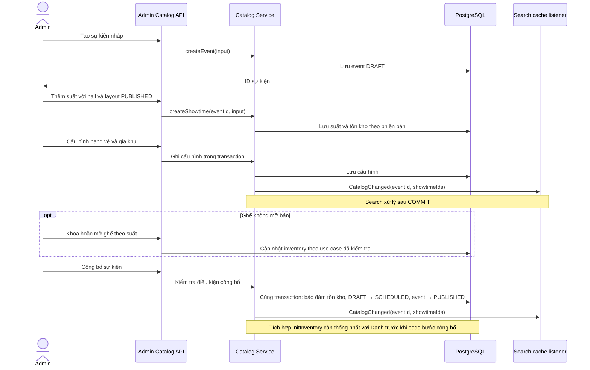

# Quản lý sự kiện · Thiết kế và bàn giao giữa các module

Ngày cập nhật: **12/11/2026**. Tiếp nối [CP7 quản lý sân](venue-management-cp7.md).

Nhánh triển khai: **`feat/create_events-luannt`**, tách từ `feat/ManageStadium-luannt` tại `f648f76`. Các file CP7 và tài liệu còn chưa commit được giữ nguyên khi chuyển nhánh. Chưa push hoặc tạo PR cho nhánh sự kiện.

Tài liệu này chốt phạm vi, ghi quyết định của Luân và các điểm tích hợp do team Search gửi. Các API/schema ghi là **đề xuất** phải đưa vào PR OpenAPI để Đức duyệt trước khi triển khai; tài liệu không thay thế `contracts/vingo-openapi.yaml`.

## 1. Luồng admin

Admin tạo sự kiện `DRAFT`, lưu thông tin chung và poster, thêm suất diễn, chọn hall cùng phiên bản sơ đồ đã công bố, cấu hình hạng vé/giá/khu, kiểm tra cấu hình rồi công bố. Sự kiện đã lưu phải mở lại được từ danh sách admin để tiếp tục chỉnh sửa.

### Luồng đã được Luân chốt

**Bắt đầu:** admin bấm **Tạo sự kiện**. **Kết thúc:** event `PUBLISHED`, các suất `DRAFT` được chọn để công bố chuyển sang `SCHEDULED`; suất đã hủy giữ `CANCELLED`. Trạng thái mở/đóng bán tính khi đọc từ các mốc thời gian, không cần job đổi trạng thái thành `ON_SALE` trong database.

1. Nhập thông tin chung, hai poster mobile/desktop và lưu sự kiện `DRAFT`.
2. Thêm từng suất: **sân → hall → cấu hình sơ đồ đã công bố → xem trước → nhập thời gian**. Chọn sân riêng cho mỗi suất để hỗ trợ nhiều địa điểm trong một sự kiện.
3. Khai báo hạng giá của sự kiện.
4. Gán hạng giá cho từng khu thuộc các phiên bản sơ đồ của các suất.
5. Khóa ghế không mở bán theo từng suất nếu cần; có thể mở lại trước khi công bố theo quy tắc được duyệt.
6. Kiểm tra cấu hình và công bố trong một transaction.

**Nhánh rẽ:** sơ đồ chưa phù hợp → chuyển sang Quản lý sân → import và công bố cấu hình mới → quay lại chọn cho suất. Không sửa khu hoặc ghế vật lý ngay trong sự kiện; suất cũ giữ nguyên phiên bản đã gắn.

**Tên cấu hình sơ đồ:** thêm `seat_layout.name`, nhập khi import; hiện khi liệt kê và xem trước. Tên bắt buộc, không trắng; cho phép trùng tên giữa các phiên bản. Đề xuất hiển thị `Concert – sân khấu đầu B · v3 · Đã công bố`. Chỉ cho chọn bản `PUBLISHED` và lưu chính xác `seat_layout_id`, không tự chọn bản mới nhất. Trong đợt đầu chỉ đổi tên khi còn `DRAFT`; cần bổ sung contract/migration trước khi triển khai hành vi này. API đổi tên bản nháp, nếu cần, phải có trong PR contract; endpoint import hiện chỉ tạo bản mới.

Giá trong đợt này theo mô hình **sự kiện × khu** hiện có. Giá riêng cho từng suất, `allocation_mode`, mẫu cấu hình bán vé và SKU là phần mở rộng cần thiết kế riêng; không đưa ngầm vào đợt tạo sự kiện này. Hủy sự kiện là luồng vận hành tiếp theo, không phải điều kiện kết thúc luồng tạo.



Nhánh hiện tại đã tạo tồn kho khi tạo suất, kể cả suất `DRAFT`. Luồng công bố phải giữ nguyên tồn kho đã có; không tạo trùng và không đặt lại `sold`/`held`.

## 2. Quyết định đã chốt: hai poster

**Luân xác nhận giữ riêng `poster_mobile_url` và `poster_desktop_url`.** Hai trường thuộc **sự kiện**, tương ứng `EventInput`/`EventDetail` trong contract hiện tại. Không gộp thành một cột poster mới dùng chung.

| Trường | Ý nghĩa và hướng triển khai |
|---|---|
| `poster_mobile_url` | URL ảnh cho mobile. Lưu trong cột riêng của `event`. |
| `poster_desktop_url` | URL ảnh cho desktop. Lưu trong cột riêng của `event`. |
| `poster_url` hiện có | Cột dữ liệu cũ, còn được Search và các luồng đơn/vé đọc. Giữ tương thích trong giai đoạn chuyển tiếp; không tự xóa hoặc tự chọn thứ tự fallback. |
| `age_limit` | Thuộc sự kiện; migration EV2 đã bổ sung cột nullable với constraint không âm. Đây là metadata, chưa kiểm tra tuổi người mua. Không đặt vào `venue`. |

Migration EV2 đã backfill `poster_url` cũ vào cả hai cột mới. Ảnh fallback cho response public vẫn có một `poster_url` và việc bắt buộc poster khi công bố còn cần phối hợp trước các mốc sau; EV2 chưa thay mapping module Search.

URL poster phải được kiểm tra tại luồng ghi: đúng cú pháp URI tuyệt đối, scheme `http`/`https`, có host; từ chối URL tương đối, thiếu host hoặc sai cú pháp bằng `400 VALIDATION_ERROR`. Việc định nghĩa validation và các trường bắt buộc phải thể hiện trong OpenAPI trước khi sinh model. Không tải nội dung URL trong transaction ghi sự kiện.

**Bàn giao team Search:** cột và migration đã được triển khai trong EV2; xem [bàn giao EV2](event-management-ev2.md) về tên cột, backfill, ví dụ response, hành vi `CatalogChanged`, kiểm tra cache và phần mapping public còn phải phối hợp.

## 3. Đối chiếu các lưu ý team Search với code hiện tại

Nguồn phối hợp: các lưu ý team gửi từ [PR #19 — Search cache](https://github.com/TNTD-dev/vingo-backend/pull/19), được Luân chuyển vào chat. Bảng dưới đối chiếu nội dung được gửi với checkout local, không thay thế kết quả review PR trên remote.

| Lưu ý từ team | Trạng thái trong nhánh `feat/ManageStadium-luannt`, nền `f648f76` | Việc phải làm |
|---|---|---|
| Phát `CatalogChanged` khi Catalog ghi dữ liệu | EV2 đã phát khi tạo nháp và PATCH có thay đổi; đổi layout suất đã phát từ CP6. Search xử lý sau commit. Giá và công bố ở các mốc sau. | Test EV2 xác nhận cache mới sau commit, rollback/no-op không invalidation. Tiếp tục bổ sung tại các use case giá/công bố. |
| Sửa sân phát `VenueChanged` | Record/listener đã có, nhưng `VenueService.update` chưa phát event. | Bổ sung cho sửa sân và các thay đổi khác ảnh hưởng response Search, kiểm tra bằng API đã làm nóng cache. |
| Publish suất gọi `bookingService.initInventory(showtimeId)` | `BookingService` trong checkout hiện tại **chưa có method này**. Catalog đang tạo/thay tồn kho trong `SeatLayoutRepository` từ bước tạo/sửa suất. | Chốt với Danh ai sở hữu thao tác, tính idempotent và transaction trước khi đổi đường gọi. Không gọi method chưa tồn tại. |
| `venue.city` phải là mã `HCM`, `HN`, `DN` | Contract dùng enum; API ghi dùng enum. Database chưa có CHECK chỉ cho ba mã; seed còn cần rà/chuyển dữ liệu. | Chuẩn bị migration mới và sửa `scripts/seed.sql`; kiểm kê giá trị cũ trước khi chuyển. Không gán bừa thành phố không nhận diện được sang mã khác. |
| Chặn URL poster sai ngay lúc ghi | POST/PATCH EV2 đã validate cả hai poster: URI tuyệt đối HTTP/HTTPS có host. | Test 400 đã có; dữ liệu URL cũ sai không gây hỏng toàn bộ GET. |
| Thiếu `age_limit`, `district`, `lat`, `lng` | Migration CP2 đã thêm ba cột sân. Migration `V20261112_1500__catalog_event_metadata.sql` bổ sung hai poster và `event.age_limit`, backfill ảnh cũ. | Không thêm lại cột; phối hợp chuyển mapping public với Đức. |

Ghi chú quan trọng về module: `BookingService` hiện gọi `SearchService`, còn Search dùng API gốc của Catalog. Nếu Catalog gọi trực tiếp `BookingService` sẽ hình thành đường phụ thuộc `catalog → booking → search → catalog`. Phải thống nhất cách tổ chức để `ModularityTest` vẫn qua, không thêm dependency này chỉ để khớp tên method trong tin nhắn bàn giao.

Trước CHECK cho city cần cập nhật cả dữ liệu test: `CatalogFixture.EventSpec.defaults()` hiện sinh mã `City-<UUID>`, và `AdminVenueIntegrationTest` còn có ca đọc mã cũ `LEGACY-CITY`. Migration thêm CHECK ngay sẽ làm các fixture này không tạo được dữ liệu. Khi triển khai phải chuyển fixture sang mã hợp lệ và kiểm tra chuyển đổi dữ liệu cũ tại đúng mốc migration, không tắt test để né constraint.

## 4. Các checkpoint của phần sự kiện

Đặt tiền tố **EV** để phân biệt với CP1–CP7 của phần quản lý sân.

| Mốc | Kết quả bàn giao | Điều kiện nghiệm thu |
|---|---|---|
| **EV1 — Contract, schema và tên cấu hình sơ đồ** | Bổ sung tên layout vào import/danh sách/xem trước; migration mới và cách backfill tên cho bản cũ; chuẩn bị schema hai poster/age, API đọc admin và semantics POST/PATCH. Ghi thống nhất tồn kho và cache với team. | PR contract có description/ví dụ lỗi được Đức review; sinh lại interface trước controller. Layout có tên, phiên bản cũ không mất liên kết; không sửa migration đã merge. |
| **EV2 — Hồ sơ sự kiện nháp** | `POST /admin/events` tạo `DRAFT`; thêm GET danh sách/chi tiết và PATCH theo contract được duyệt; lưu hai poster, attributes và giới hạn vé. | Admin mở lại nháp và sửa mà không mất dữ liệu; PATCH tên không đổi giới hạn vé; URL được validate; test 400/401/403/404 và cursor. |
| **EV3 — Chọn địa điểm và sơ đồ theo suất** | Tái sử dụng API tạo/sửa suất CP6; chọn sân/hall/layout có tên cho từng suất; xem trước và trả cả suất nháp trong chi tiết admin. | Một event có hai suất tại hai sân; từ chối layout nháp/sai hall; không sửa khu tại event; phiên bản và tồn kho theo suất chính xác. |
| **EV4 — Hạng giá và gán giá khu** | `PUT /admin/events/{id}/price-tiers`, `PUT /admin/events/{id}/zone-prices`; hạng giá thuộc event, mỗi khu một hạng theo contract. | Tiền nguyên VND; tier/khu đúng event và layout đang dùng; kiểm tra trùng/thiếu/tham chiếu sai; ghi đúng transaction và phát `CatalogChanged`; không đổi giá đã lưu trong đơn. |
| **EV5 — Khóa và mở ghế theo suất** | `POST /admin/showtimes/{id}/seats/block` và `/unblock`; thao tác trên inventory của suất, giữ nguyên sơ đồ vật lý. | Chỉ đổi trạng thái ghế hợp lệ theo contract; không khóa ghế đang HELD/SOLD; lỗi không cập nhật dở một phần. Chốt với Danh và duyệt test trước code nghiệp vụ inventory. |
| **EV6 — Kiểm tra và công bố** | `POST /admin/events/{id}/publish`; kiểm tra suất/giá/gán khu, bảo đảm tồn kho, event → `PUBLISHED`, suất `DRAFT` hợp lệ → `SCHEDULED`, phát `CatalogChanged` trong transaction. | Thiếu cấu hình trả `422 EVENT_INCOMPLETE`, không đổi trạng thái/tồn kho; gọi lại không nhân bản/reset inventory; giữ ghế BLOCKED; test đồng thời với cập nhật cấu hình và không phát event khi rollback. |
| **EV7 — Nghiệm thu và bàn giao** | Luồng tạo nháp → suất → giá → khóa ghế tùy chọn → công bố → đọc public; case quay lại Quản lý sân, nhiều sân, phiên bản khác nhau; dữ liệu mẫu và tài liệu team. | `mvnw verify`/`ModularityTest` qua trên PostgreSQL thật; xác thực 401/403, 4xx, cache sau commit/rollback, tồn kho và giờ mở bán; PR/review và Swagger staging có bằng chứng riêng. |

**Hiện tại:** EV2 đã đạt nghiệm thu backend local ngày 12/11/2026: `clean verify` qua **489 test**, gồm **70 ca EV2** và `ModularityTest`. Xem [bàn giao EV2](event-management-ev2.md) để biết hành vi, giới hạn và kết quả. Bước tiếp theo là EV3. Tên cấu hình sơ đồ, hạng giá, khóa ghế và công bố vẫn theo các mốc riêng, không được coi là hoàn thành từ EV2.

### Thứ tự commit/PR và điều kiện hoàn thành

1. Giữ nguyên các file CP7 đang có. Khi commit, tách phần CP7 với phần sự kiện để lịch sử review rõ ràng; không tự stage toàn bộ working tree.
2. Chuẩn bị PR contract/migration của EV1 trước. Bổ sung mô tả/mã lỗi cho endpoint đã có cũng là thay YAML và vẫn phải qua PR theo `CLAUDE.md`.
3. Triển khai lần lượt EV2 → EV3 → EV4. EV3 tái sử dụng CP6, chỉ bổ sung phần còn thiếu để nối vào sự kiện.
4. Chốt hợp đồng inventory với Danh trước EV5–EV6. Không import `booking.internal`, không thêm vòng phụ thuộc module và không tự sửa module của Danh khi chưa báo.
5. Hoàn thành EV5 → EV6 → EV7. Mỗi mốc có test cho nhánh thành công và các lỗi contract; chạy `verify` trước khi ghi nhận mốc hoàn thành.

**Định nghĩa hoàn thành đợt này:** admin tạo được event từ đầu, thêm các suất với sơ đồ đã chọn, khai báo/gán giá, khóa ghế tùy chọn và công bố thành công; các API public đọc được sự kiện và tồn kho đúng, mở bán theo giờ. Có migration, test, cache invalidation, tài liệu và PR đã review. UI admin, dashboard thống kê và các mở rộng cách cấp chỗ được nghiệm thu riêng.

## 5. Contract hồ sơ sự kiện EV2

Mọi endpoint admin dùng Bearer JWT và quyền `ADMIN`. Hai API GET đã bổ sung vào contract và triển khai controller trong EV2; thay đổi local cần được đưa vào PR của team.

| API | Hành vi dự kiến |
|---|---|
| `POST /api/v1/admin/events` | Tạo `DRAFT`. Bắt buộc `title` không trắng và `category`; các trường khác theo schema đã duyệt. Mặc định giới hạn 10 vé mỗi đơn tại luồng tạo. |
| `GET /api/v1/admin/events?q=&status=&category=&cursor=&limit=20` **(mới)** | Danh sách admin, gồm sự kiện nháp. Đề xuất sắp xếp `created_at DESC, id DESC`, cursor ổn định, limit 1–100. Response có `data`, `next_cursor`; mỗi dòng có ID, tên, loại, trạng thái, hai poster và thời gian cập nhật. |
| `GET /api/v1/admin/events/{event_id}` **(mới)** | Đọc chi tiết để chỉnh sửa, gồm sự kiện nháp và các suất nháp. Không dùng `SearchService.getEvent`, vì API public chỉ trả sự kiện `PUBLISHED`. |
| `PATCH /api/v1/admin/events/{event_id}` | Sửa trường khác null trên event DRAFT/PUBLISHED; không cập nhật layout, giá hoặc tồn kho. ENDED/CANCELLED trả 409 EVENT_LOCKED. |

EV2 dùng `EventCreateInput` cho POST (default giới hạn 10), `EventPatchInput` cho PATCH (không default), còn `EventInput` chứa các trường chung cho response. Test xác nhận PATCH chỉ sửa tên vẫn giữ giới hạn 4. Không sửa file sinh trong `target/generated-sources`.

PATCH quy định trường không gửi hoặc null giữ nguyên; không hỗ trợ xóa giá trị bằng null. `attributes` khác null thay toàn bộ object; mô tả rỗng và object thuộc tính rỗng được phép. Body không có giá trị cập nhật là no-op, không đổi timestamp hoặc cache.

Ví dụ body tạo nháp, với URL minh họa:

```json
{
  "title": "Trận đấu minh họa",
  "category": "FOOTBALL",
  "description": "Nội dung giới thiệu sự kiện",
  "attributes": {
    "home_team": "Đội A",
    "away_team": "Đội B",
    "league": "Giải minh họa"
  },
  "poster_mobile_url": "https://example.com/event-mobile.jpg",
  "poster_desktop_url": "https://example.com/event-desktop.jpg",
  "max_tickets_per_order": 4
}
```

Luồng kiểm tra EV2 quan trọng: tạo nháp với giới hạn 4 → lấy lại bằng GET admin → PATCH chỉ `title` → hai poster, attributes và giới hạn 4 vẫn giữ nguyên. Buyer và request không token lần lượt bị từ chối 403 và 401.

## 6. Quy tắc phát event và tồn kho cho team

- Phát event bên trong transaction use case; Search đã dùng listener `AFTER_COMMIT`. Không tự xóa Redis trước khi commit và không phát event từ controller.
- Sửa thông tin chung của event: `CatalogChanged(eventId, showtimeIds)` chứa các suất mà response/cache bị ảnh hưởng. Với thông tin chỉ thuộc event có thể dùng tập rỗng theo tài liệu record; khi trạng thái/giá/layout ảnh hưởng suất phải kèm tập ID đầy đủ.
- Công bố/hủy event, đổi hạng giá, `zone_price`, sửa suất: kiểm kê các suất bị ảnh hưởng rồi phát `CatalogChanged`. Khi công bố layout, xác định các event/suất đã tham chiếu nếu có; không bịa event ID khi layout chưa gắn suất nào.
- Sửa thông tin sân: phát `VenueChanged(venueId)`; bàn giao cho Đức kiểm tra invalidation các event/suất có venue trong response.
- Tạo tồn kho phải cùng transaction với bước làm suất có thể bán, đủ ghế/khu theo phiên bản, gọi lại không tạo trùng hoặc reset dữ liệu bán. Không dùng Redis làm tồn kho và không cập nhật bảng booking từ một transaction độc lập.

## 7. Điểm dữ liệu/tích hợp còn cần chốt

1. **Poster public:** backfill đã xong trong EV2; còn thứ tự fallback trong response một poster và thời điểm chuyển reader khỏi `poster_url`.
2. **`age_limit`:** EV2 chỉ lưu metadata không âm, có thể chưa khai báo; xác minh tuổi khi mua là yêu cầu riêng, chưa thuộc EV2.
3. **Tồn kho:** method của Danh, tính idempotent, xử lý tồn kho đã tạo lúc nháp và hướng phụ thuộc module.
4. **CityCode:** ba mã đang có là HCM/HN/DN; quy tắc với địa điểm ngoài ba mã, đặc biệt SVG Thiên Trường. Mã `HN` trong bài CP7 chỉ là fixture, không phải quyết định địa lý.
5. **Giá theo suất:** đợt hiện tại giữ `price_tier`/`zone_price` theo event như contract. Nếu mở rộng giá khác nhau giữa các suất dùng cùng layout, phải có thiết kế/schema/contract riêng.
6. **Ba cách cấp chỗ:** là yêu cầu mở rộng đã thảo luận; hạng vé độc lập với tự chọn ghế, hệ thống cấp ghế và khu đứng. Contract/schema hiện chưa có `allocation_mode`; chốt riêng cùng Danh trước khi đưa vào booking. Không có phân loại Người lớn/Trẻ em trong phạm vi đã thống nhất.

## 8. Checklist bàn giao PR

- [ ] PR OpenAPI có description và ví dụ lỗi cho POST/PATCH và hai GET mới; Đức review.
- [ ] `seat_layout.name` có trong import/danh sách/xem trước; tên không trắng; có backfill cho layout cũ và tên trùng giữa phiên bản được hỗ trợ.
- [ ] Schema tạo/sửa không làm PATCH áp lại default; validation URL và semantics null rõ ràng.
- [ ] Migration mới cho event; giữ nguyên migration đã merge; thống nhất mapping với Search.
- [ ] Mọi luồng ghi liên quan phát đúng `CatalogChanged`/`VenueChanged`.
- [ ] Hợp đồng tạo tồn kho được thống nhất với Danh và không gây vòng module.
- [ ] Migration city/seed có mapping dữ liệu cũ được team chấp nhận.
- [ ] Test trên PostgreSQL thật, lỗi 4xx, cache, rollback và ranh giới module đều qua.
- [ ] Có log `request_id`, `event_id`/`showtime_id` phù hợp, không log body/token.
- [ ] `mvnw verify` qua trên source triển khai; thử Swagger staging và ghi bằng chứng riêng.

Tài liệu bàn giao này không tự gửi tin nhắn cho Đức/Danh và không khẳng định các bên đã duyệt hoặc triển khai những đầu việc còn mở.

## 9. Kiểm tra nền trước khi triển khai (lịch sử)

`mvnw verify` hoàn tất **14:04:33 ngày 12/11/2026 (UTC+07)**: `BUILD SUCCESS`, **419 test qua, 0 failure, 0 error, 0 skipped**, gồm `ModularityTest`. Log ở `target/event-management-baseline-verify.log`. Ví dụ JSON trong tài liệu đã được kiểm tra đọc được và dùng hai URL poster riêng. `git diff --check` không báo lỗi.

Đây là kết quả ở thời điểm lập kế hoạch, không phải bằng chứng nghiệm thu các API EV2 mới. Kết quả triển khai hiện tại được ghi riêng tại [bàn giao EV2](event-management-ev2.md).
