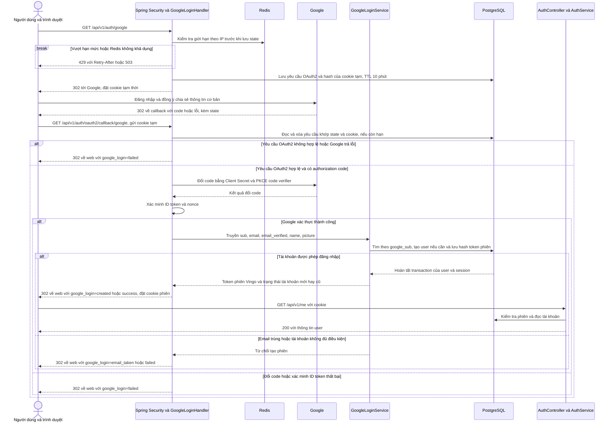

# Đăng nhập Google trong Vingo

Vingo dùng **OAuth 2.0 Authorization Code + OpenID Connect (OIDC)**. Google xác thực danh tính người dùng. Backend Vingo dùng danh tính đó để tìm hoặc tạo tài khoản, sau đó cấp phiên riêng của Vingo. Trình duyệt gửi cookie phiên khi gọi API. [Google OpenID Connect](https://developers.google.com/identity/openid-connect/openid-connect) · [Spring Security OAuth2 Login](https://docs.spring.io/spring-security/reference/servlet/oauth2/login/advanced.html)

## 1. Phạm vi triển khai

- Bổ sung luồng điều hướng qua `GET /api/v1/auth/google` và callback do Spring Security xử lý. OpenAPI vẫn giữ operation `POST /api/v1/auth/google` nhận ID token từ `develop`. Luồng browser dùng `GET`, còn operation `POST` hiện dùng stub sinh từ OpenAPI và chưa hỗ trợ xác minh ID token.
- Tạo tài khoản `BUYER` ở lần đăng nhập đầu, lưu Google `sub` và avatar nếu có. Lần sau dùng lại UUID Vingo theo `google_sub`.
- Tạo phiên trong PostgreSQL cho mỗi lượt đăng nhập thành công. Trình duyệt nhận token phiên qua cookie `HttpOnly`.
- Thu hồi một phiên hoặc mọi phiên của tài khoản khi logout.
- Ghi mã lỗi callback trong log để phân biệt sự cố OAuth2 với lỗi kết nối trang frontend sau redirect.

[Contract OpenAPI](../contracts/vingo-openapi.yaml) · [Migration Google login](../src/main/resources/db/migration/V20261111_1030__auth_google_login.sql)

## 2. Sequence đăng nhập



Google trả người dùng về **callback của backend** trên cổng `8080`. Sau khi xử lý xong, backend chuyển tiếp người dùng đến **trang nhận kết quả của frontend**, mặc định là `http://localhost:3000/auth/google`. Giá trị `google_login` phục vụ hiển thị thông báo. Frontend xác nhận phiên bằng phản hồi `200` từ GET /api/v1/me.

## 3. Trách nhiệm của từng lớp

| Thành phần | Trách nhiệm |
|---|---|
| [`GoogleOAuth2SecurityConfig`](../src/main/java/vingo/auth/web/oauth2/GoogleOAuth2SecurityConfig.java) | Đăng ký Google client, bật PKCE, cấu hình hai đường dẫn OAuth2 và gắn success/failure handler. Filter chain này chỉ áp dụng cho trang bắt đầu và callback. |
| [`GoogleLoginStartFilter`](../src/main/java/vingo/auth/web/oauth2/GoogleLoginStartFilter.java) và [`GoogleLoginRateLimiter`](../src/main/java/vingo/auth/internal/GoogleLoginRateLimiter.java) | Giới hạn request bắt đầu theo IP bằng Redis trước khi Spring dọn hoặc lưu state trong PostgreSQL. |
| [`GoogleAuthorizationRequests`](../src/main/java/vingo/auth/web/oauth2/GoogleAuthorizationRequests.java) | Nối Spring Security với kho yêu cầu OAuth2. Tạo cookie tạm, chuyển yêu cầu OAuth2 thành dữ liệu lưu trữ và khôi phục yêu cầu khi callback quay về. |
| [`GoogleLoginHandler`](../src/main/java/vingo/auth/web/oauth2/GoogleLoginHandler.java) | Đọc claim từ `OidcUser` đã xác thực, gọi use case, đặt cookie phiên và redirect. |
| [`GoogleLoginService`](../src/main/java/vingo/auth/GoogleLoginService.java) | Kiểm tra điều kiện tài khoản, tìm hoặc tạo user, tạo session trong một transaction. |
| [`AuthController`](../src/main/java/vingo/auth/web/AuthController.java) và [`AuthService`](../src/main/java/vingo/auth/AuthService.java) | Nhận HTTP login/logout, xử lý vòng đời phiên và trả kết quả theo OpenAPI. |
| [`AuthRepository`](../src/main/java/vingo/auth/internal/AuthRepository.java) và [`GoogleAuthorizationRequestRepository`](../src/main/java/vingo/auth/internal/GoogleAuthorizationRequestRepository.java) | Thực hiện SQL trên `user_account`, `login_session` và `oauth_state`. |

Luồng nghiệp vụ đi theo **điểm vào HTTP → service → repository → PostgreSQL**. Callback OAuth2 đi qua Spring Security và `GoogleLoginHandler`. Kho trạng thái OAuth2 là hạ tầng của filter chain, được gọi qua adapter riêng. Các service và `AuthUser` nằm ở package gốc `vingo.auth`. DTO nội bộ nằm trong `vingo.auth.internal`. Các kiểu HTTP như `User` và `LoginResult` được sinh từ OpenAPI.

## 4. Vì sao chọn cách này?

### Xác thực Google ở backend

Frontend điều hướng trình duyệt đến endpoint bắt đầu. Backend dùng Spring Security để quản lý authorization code, đổi code với Google, kiểm tra ID token và tạo `OidcUser`. Client Secret được đọc từ cấu hình backend. ID token và access token của Google phục vụ bước xác thực, rồi được bỏ sau callback. Scope `openid email profile` cung cấp danh tính, email và thông tin hồ sơ cần cho đăng nhập.

- **`state` và cookie tạm** gắn callback với lượt đăng nhập đã bắt đầu trong trình duyệt. Backend yêu cầu cả hai cùng khớp một yêu cầu còn hạn.
- **PKCE S256** gắn authorization code với code verifier mà backend giữ. Google kiểm tra verifier khi đổi code.
- **OIDC nonce** gắn ID token với yêu cầu đăng nhập ban đầu. Spring kiểm tra nonce trong quá trình xác thực.
- **PostgreSQL cho trạng thái OAuth2** cho phép một replica bắt đầu luồng và replica khác nhận callback. Bảng có TTL 10 phút. Callback hợp lệ lấy và xóa bản ghi bằng một câu SQL `DELETE … RETURNING`. Yêu cầu hết hạn bị bỏ qua khi đọc và được dọn khi lưu yêu cầu mới.
- **Giới hạn bắt đầu đăng nhập** mặc định là 10 lượt/IP trong 60 giây, điều chỉnh bằng `GOOGLE_LOGIN_RATE_LIMIT_PER_MINUTE`. Vượt hạn mức trả `429` kèm `Retry-After`. Nếu Redis không khả dụng, trang bắt đầu trả `503` để tránh tạo state khi bộ giới hạn ngừng hoạt động. Callback của lượt đã bắt đầu vẫn được xử lý. Ở deploy Compose, Tomcat lấy IP qua Caddy và các replica dùng chung Redis.

### Dùng Google `sub` để nhận diện tài khoản

`sub` là định danh ổn định của tài khoản Google. Email dùng để tạo hồ sơ và phát hiện xung đột với tài khoản Vingo hiện có. Quy tắc áp dụng sau khi Spring xác thực Google:

| Điều kiện | Kết quả |
|---|---|
| Thiếu `sub`, thiếu email hoặc email chưa xác minh | Từ chối tạo phiên. |
| Đã có `google_sub` và tài khoản là `BUYER` đang `ACTIVE` | Dùng lại UUID và tạo phiên mới. |
| Chưa có `google_sub` và email chưa được dùng | Tạo `BUYER` ở trạng thái `ACTIVE`. Email được chuẩn hóa chữ thường. Dùng email làm tên nếu Google thiếu tên. Avatar là URL HTTPS nếu có. |
| Email đã có chủ và `google_sub` chưa khớp | Trả `email_taken`. Người dùng cần xác thực tài khoản Vingo hiện có trước khi liên kết. Luồng liên kết là phần việc riêng. |
| Tài khoản liên kết đã bị khóa, xóa hoặc có role ngoài `BUYER` | Từ chối tạo phiên Google. |

Email và `google_sub` có unique index. Khi hai callback tạo tài khoản cùng lúc, `INSERT … ON CONFLICT DO NOTHING` rồi đọc lại theo `google_sub` giúp cả hai lượt dùng cùng một user. Tài khoản Google mới có `password_hash = NULL` vì họ đã xác thực bằng Google. Nếu Vingo bổ sung đăng nhập mật khẩu cho tài khoản này, người dùng có thể tự đặt mật khẩu sau khi xác thực lại.

### Phiên Vingo sau callback

Cookie phiên dùng HttpOnly, SameSite=Lax và Path=/; khi bật Secure, tên cookie là `__Host-vingo_session`. Backend tra hash SHA-256, đọc vai trò hiện tại và kiểm tra hạn tuyệt đối (mặc định 7 ngày kể từ lúc đăng nhập). Hoạt động và đổi token đều giữ nguyên mốc hết hạn. Xóa dòng phiên sẽ thu hồi quyền truy cập ở request tiếp theo.

## 5. Frontend xác nhận phiên

Sau redirect, web gọi `GET /api/v1/me` với cookie để lấy hồ sơ. Dùng đường dẫn API cùng origin qua reverse proxy khi frontend và backend ở hai cổng khác nhau; mapping CORS riêng của auth chỉ áp dụng cho logout. Request POST/PUT/PATCH/DELETE dùng cookie phải gửi Origin khớp `AUTH_FRONTEND_RETURN_URL`. Đăng xuất bằng `POST /api/v1/auth/logout`. Client server-to-server có thể gửi cùng token opaque qua Authorization Bearer.

## 6. Cấu hình và kiểm thử local

1. Trong [Google Auth Platform → Clients](https://console.cloud.google.com/auth/clients), chọn OAuth client loại **Web application**. Thêm `http://localhost:8080/api/v1/auth/oauth2/callback/google` vào **Authorized redirect URIs**.
2. Tạo `.env.local` ở thư mục gốc của backend, lưu UTF-8 không BOM. Git bỏ qua file này. Thay các giá trị mẫu bằng cấu hình của bạn.

   ```properties
   GOOGLE_LOGIN_ENABLED=true
   GOOGLE_CLIENT_ID=your-client-id
   GOOGLE_CLIENT_SECRET=your-client-secret
   GOOGLE_REDIRECT_URI=http://localhost:8080/api/v1/auth/oauth2/callback/google
   AUTH_FRONTEND_RETURN_URL=http://localhost:3000/auth/google
   ```

3. Khởi động PostgreSQL, Redis và backend từ PowerShell.

   ```powershell
   docker compose -f deploy/compose.dev.yaml up -d
   .\mvnw.cmd spring-boot:run "-Dspring-boot.run.profiles=api,local"
   ```

4. Khi frontend chưa chạy, dùng `AUTH_FRONTEND_RETURN_URL=http://localhost:8080/actuator/health` để quan sát tham số `google_login` trên thanh địa chỉ. JSON `status=UP` chỉ báo tình trạng backend.
5. Mở [trang bắt đầu đăng nhập Google](http://localhost:8080/api/v1/auth/google). Với email mới, mong đợi `created`. Đăng nhập lại cùng tài khoản để kiểm tra `success` và UUID Vingo giữ nguyên. Gọi GET /me bằng cookie, sau đó logout và xác nhận cùng cookie trả 401.

### Lệnh test tự động

```powershell
.\mvnw.cmd "-Dtest=GoogleLoginServiceTest" test
.\mvnw.cmd "-Dtest=GoogleLoginIntegrationTest" test
.\mvnw.cmd clean verify
```

Test tích hợp dùng PostgreSQL 18 và Redis để kiểm tra state, giới hạn tần suất, tạo tài khoản đồng thời, email trùng, xác thực phiên và logout. Test callback HTTP đi qua filter chain thật, dùng token endpoint và JWK Set mô phỏng trên loopback để đổi code, kiểm tra chữ ký và nonce. Có test riêng cho các đường dẫn Google khi tính năng tắt. Bước đổi code với Google thật được kiểm tra thủ công bằng trình duyệt.

### Lỗi local đã gặp

| Triệu chứng | Nguyên nhân hoặc cách kiểm tra |
|---|---|
| `NoClassDefFoundError: DomainException` khi khởi động | `target/classes` từng chứa bytecode lỗi. Dừng JAR đang chạy trước, chạy `.\mvnw.cmd clean package "-DskipTests"` rồi khởi động JAR mới. |
| `404` khi mở trang bắt đầu | Kiểm tra `GOOGLE_LOGIN_ENABLED=true`, profile `api,local` và mã hóa UTF-8 không BOM. BOM ở đầu file từng khiến Spring bỏ qua key đầu tiên. |
| `ERR_CONNECTION_REFUSED` tại cổng `3000` sau callback | Frontend chưa nghe ở địa chỉ trả về. Khởi động frontend hoặc dùng URL health như bước 4 để test backend riêng. |
| URL có `google_login=failed` | Xem dòng `Google OAuth2 callback rejected: reason=` hoặc `Google sign-in rejected: reason=` trong terminal. `authorization_request_not_found` gợi ý kiểm tra lượt đăng nhập còn hạn, URL bắt đầu và cookie trong cùng trình duyệt. Log chỉ ghi mã lỗi được chọn. |
| Google báo `redirect_uri_mismatch` | So sánh `GOOGLE_REDIRECT_URI` và URI trong Google Cloud, gồm scheme, host, port, path và dấu gạch chéo cuối. |
| API báo `401` hoặc `403` | Với `401`, kiểm tra cookie còn hạn và phiên chưa bị thu hồi. Với `403`, kiểm tra `Origin` của frontend. Ở local, dùng `localhost` nhất quán cho frontend và API. |
