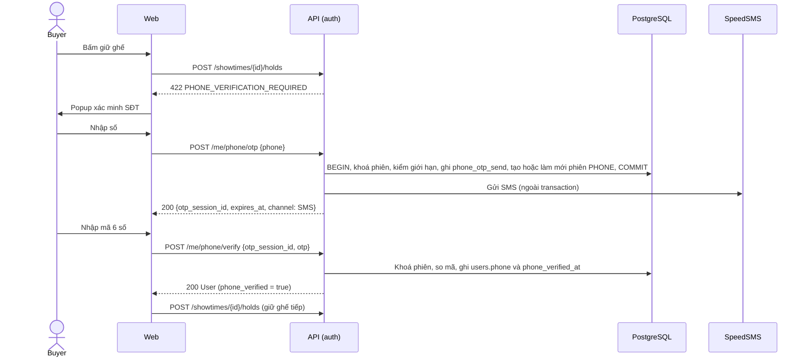

# Xác minh số điện thoại bằng SMS OTP

Chống bot giữ ghế hàng loạt: buyer phải có SĐT đã xác minh qua SMS OTP thì mới giữ được ghế. Đăng ký bằng email và đăng nhập Google giữ nguyên. Module chính: `auth` (gửi, xác minh) và `booking` (cổng chặn khi giữ ghế).

## 1. Luật nghiệp vụ

| Luật | Chi tiết |
|---|---|
| Ai phải xác minh | BUYER. ADMIN được miễn. |
| Chặn ở đâu | `POST /showtimes/{id}/holds`. Chưa xác minh (hoặc chưa có SĐT, ví dụ tài khoản Google) trả **422 `PHONE_VERIFICATION_REQUIRED`**. Cổng chạy trước idempotency và trước khi tạo đơn: không ghi `idempotency_key`, không tạo đơn. |
| Số hợp lệ | Chỉ số di động Việt Nam: `^(\+84\|84\|0)(3\|5\|7\|8\|9)[0-9]{8}$` sau khi bỏ khoảng trắng, dấu chấm, gạch ngang. Lưu dạng E.164 (`+84912345678`). |
| Số đã bị người khác xác minh | **409 `PHONE_TAKEN`**. Mỗi số chỉ thuộc một tài khoản đã xác minh (unique index chỉ áp cho số đã xác minh). Số mới chỉ khai báo, chưa xác minh, không chiếm quyền. |
| Đổi số | `PATCH /me` đổi `phone` sang số khác thì `phone_verified` về `false`. Giữ nguyên số (sau chuẩn hoá) thì giữ cờ. |
| Xoá tài khoản | Giải phóng số (xoá `phone` và `phone_verified_at`). |
| Đăng nhập bằng SĐT | Chỉ với số đã xác minh. Tài khoản chưa xác minh dùng email. Số sai, chưa xác minh hoặc sai mật khẩu đều trả 401 `INVALID_CREDENTIALS`. |
| Đăng ký | `PHONE_TAKEN` chỉ khi số đã được người khác xác minh. Số chưa xác minh trùng nhau vẫn đăng ký được; `users.phone` giữ nguyên dạng người dùng nhập. |
| Người dùng cũ | Chưa ai xác minh, phải xác minh mới giữ được ghế. |

## 2. Luồng



## 3. API

| API | Quyền | Kết quả |
|---|---|---|
| `POST /me/phone/otp` `{phone}` | BUYER, ADMIN | 200 `OtpSession` (kênh `SMS`). 400 `VALIDATION_ERROR`, 401, 409 `PHONE_TAKEN`, 429 `RATE_LIMITED` (kèm `Retry-After`), 503 `SERVICE_UNAVAILABLE` (nhà cung cấp SMS lỗi). |
| `POST /me/phone/verify` `{otp_session_id, otp}` | BUYER, ADMIN | 200 `User` với `phone_verified=true`. 400 `OTP_INVALID`, `OTP_EXPIRED`, `OTP_TOO_MANY_ATTEMPTS`, `VALIDATION_ERROR`. 401. 409 `PHONE_TAKEN`. |
| `POST /showtimes/{id}/holds` | BUYER, ADMIN | Thêm 422 `PHONE_VERIFICATION_REQUIRED`. |

- Phiên OTP phải thuộc đúng user đang gọi. Phiên không tồn tại, của người khác, sai mục đích, đã dùng hoặc sai mã đều trả `OTP_INVALID`, không để lộ phiên của người khác.
- Sai mã tăng số lần thử; số lần tăng được commit kể cả khi trả lỗi. Tối đa `AUTH_OTP_MAX_ATTEMPTS` (mặc định 5) lần mỗi phiên, mã sống `AUTH_OTP_TTL` (mặc định 5 phút).
- Gửi lại làm mới **cùng một phiên**: mã mới, `attempts` về 0, hạn mới. Mã cũ hết tác dụng.
- `User.phone_verified` luôn có trong kết quả đăng nhập, refresh, `GET /me`, `PATCH /me`.

## 4. Giới hạn gửi SMS (SMS tốn tiền)

Cả bốn giới hạn đều đếm trong PostgreSQL (bảng `phone_otp_send`), không dùng Redis, vì Redis chạy kiểu fail-open (Redis chết thì bỏ qua giới hạn) mà SMS tốn tiền thật. IP được lưu dưới dạng bản băm (`client_key`), không lưu IP thô.

| Giới hạn | Mặc định | Biến cấu hình |
|---|---|---|
| Giữa hai lần gửi của một user | 60 giây | `AUTH_PHONE_OTP_RESEND_COOLDOWN` |
| Mỗi user | 5 tin / 24 giờ | `AUTH_PHONE_OTP_USER_MAX` |
| Mỗi số điện thoại (mọi user) | 5 tin / 24 giờ | `AUTH_PHONE_OTP_PHONE_MAX` |
| Mỗi IP | 20 tin / 24 giờ | `AUTH_PHONE_OTP_IP_MAX` |
| Cửa sổ đếm | 24 giờ | `AUTH_PHONE_OTP_WINDOW` |

- Lần dò số đã bị người khác xác minh (`PHONE_TAKEN`) **cũng tính lượt** và cooldown, để không dò số vô hạn.
- Lần gửi mà nhà cung cấp báo lỗi (503) vẫn tính lượt.
- Vượt giới hạn trả 429 kèm `Retry-After` (số giây còn lại).

## 5. Dữ liệu

Migration `V20261118_1000__auth_phone_verification.sql`:

- `users.phone_verified_at` + ràng buộc: có xác minh thì phải có `phone`.
- `users_phone_uk` (unique mọi số) được thay bằng `users_verified_phone_uk` (unique **chỉ số đã xác minh**).
- `otp_session`: mục đích mới `PHONE`, cột `phone` (số đang xác minh). Chỉ có một phiên `PHONE` đang mở cho mỗi user.
- `phone_otp_send(id, user_id, phone, client_key, sent_at)` để đếm giới hạn và làm nhật ký chi phí. `client_key` là UUID băm từ IP. Bảng chưa có job dọn dẹp; mỗi user tối đa 5 dòng mỗi ngày.

## 6. Cấu hình

Khai báo trong `application.yml` mục `vingo.sms`. Đặt giá trị thật trong `.env.local` (máy dev) hoặc `deploy/.env` (server).

| Biến | Mặc định | Ý nghĩa |
|---|---|---|
| `SPEEDSMS_ACCESS_TOKEN` | (trống) | Token SpeedSMS: connect.speedsms.vn → Cài đặt → Hồ sơ. Trống thì xin OTP trả 503. **Bí mật, không commit, không dán vào chat.** |
| `SPEEDSMS_SMS_TYPE` | `4` | `2` đầu số ngẫu nhiên, `3` brandname riêng (cần `SPEEDSMS_SENDER`), `4` brandname mặc định Verify/Notify. Nhà mạng đã ngừng brandname dùng chung: tài khoản chưa đăng ký brandname riêng gửi loại 2/4 sẽ nhận `sender not found`. |
| `SPEEDSMS_SENDER` | (trống) | Brandname, chỉ cần khi loại `3`. |
| `SPEEDSMS_BASE_URL` | `https://api.speedsms.vn/index.php` | Chỉ nhận HTTPS. |
| `SMS_PROVIDER` | `speedsms` | `speedsms`, `log` (chỉ local/test) hoặc `demo` (xem dưới). |
| `SMS_LOG_CODE` | `false` | `true` thì vẫn gọi SpeedSMS nhưng in mã OTP ra log. |

**Chế độ chỉ dùng trên máy dev (profile `local`):**

- `SMS_PROVIDER=log`: không gọi SpeedSMS, mã OTP in ra log dòng `DEV ONLY - mã OTP SMS: ...`.
- `SMS_LOG_CODE=true`: gọi SpeedSMS thật và in thêm mã ra log.
- Đặt hai biến này ở profile khác (`api`, `worker`) thì **app không khởi động**. Đây là chốt chặn có chủ ý, vì ghi OTP ra log trái quy tắc bảo mật.

**Chế độ demo (`SMS_PROVIDER=demo`), dùng được cả trên staging:** không gọi nhà cung cấp, không gửi SMS. Phản hồi của `POST /me/phone/otp`
kèm header `X-Demo-Otp: <mã 6 số>` để web (bật `VITE_DEMO_OTP=true`) hiện mã lên màn hình. Mã vẫn được băm, vẫn hết hạn sau 5 phút và vẫn
bị giới hạn số lần nhập sai như thường; chỉ khác là ai gọi API xin mã cũng đọc được mã. Vì vậy chế độ này chỉ dành cho môi trường
demo/thực tập không có dữ liệu thật. **Không đặt ở production**: app chỉ in cảnh báo khi khởi động, không tự chặn.

**SpeedSMS không có sandbox**: mỗi lần gọi thật là gửi thật và tính tiền. Muốn thử luồng không tốn tiền thì dùng `SMS_PROVIDER=log`.

Gọi SpeedSMS: `GET https://api.speedsms.vn/index.php/sms/send` với `access-token`, `to` (dạng `84912345678`), `content`, `type`, `sender` (chỉ loại 3). Token nằm trên URL nên code không bao giờ log URL và không đính kèm nguyên nhân lỗi mạng vào thông báo lỗi. Nội dung tin không dấu: `Vingo: ma xac minh cua ban la {code}. Co hieu luc 5 phut. Khong chia se ma nay cho bat ky ai.`

## 7. Thử trên máy local

Dùng database riêng `vingo_phone` để migration mới không ảnh hưởng database `vingo`. Ví dụ dưới chạy trên PowerShell, tại thư mục gốc repo.

1. Bật Postgres và Redis, tạo database:
   ```powershell
   docker compose -f deploy/compose.dev.yaml up -d
   docker compose -f deploy/compose.dev.yaml exec -T postgres psql -U vingo -d vingo -c "CREATE DATABASE vingo_phone"
   ```
2. Tạo `.env.local` ở thư mục gốc:
   ```
   DB_URL=jdbc:postgresql://localhost:5432/vingo_phone
   SMS_PROVIDER=log
   ```
3. Chạy API (Flyway tự tạo bảng), chờ dòng `Started VingoApplication`:
   ```powershell
   $env:JAVA_HOME = "D:\JDK25"
   .\mvnw.cmd spring-boot:run "-Dspring-boot.run.profiles=api,local"
   ```
4. Tạo hai tài khoản thử (mật khẩu `Vingo@2026`, cùng hash trong `scripts/seed.sql`). `buyer3` chưa xác minh, `buyer2` đã xác minh `+84900000003`. Chạy trong `psql` hoặc qua `docker compose ... exec -T postgres psql -U vingo -d vingo_phone`:
   ```sql
   INSERT INTO users (email, phone, full_name, password_hash, role, status, phone_verified_at) VALUES
     ('buyer3@vingo.local', NULL,           'Buyer Ba',  '$argon2id$v=19$m=16384,t=2,p=1$RcFCYFjO41/Yy1aVhfrhFA$DxphoNYrGaJkZEoh8AXZB6TmW/8MPSGalW7lpf0bNMw', 'BUYER', 'ACTIVE', NULL),
     ('buyer2@vingo.local', '+84900000003', 'Buyer Hai', '$argon2id$v=19$m=16384,t=2,p=1$RcFCYFjO41/Yy1aVhfrhFA$DxphoNYrGaJkZEoh8AXZB6TmW/8MPSGalW7lpf0bNMw', 'BUYER', 'ACTIVE', now())
   ON CONFLICT DO NOTHING;
   ```
5. Đăng nhập `buyer3` lấy `access_token` (trong PowerShell phải dùng `curl.exe`, và bỏ khoảng trắng trong số điện thoại khi gõ JSON):
   ```powershell
   curl.exe -s -X POST http://localhost:8080/api/v1/auth/login -H "Content-Type: application/json" -d '{\"identifier\":\"buyer3@vingo.local\",\"password\":\"Vingo@2026\"}'
   ```
6. Các ca kiểm tra, mỗi ca với `$TOKEN` là `access_token` vừa lấy:

   | Ca | Thao tác | Mong đợi |
   |---|---|---|
   | A | Giữ ghế (id suất bất kỳ) | 422 `PHONE_VERIFICATION_REQUIRED` |
   | B | `POST /me/phone/otp` `{"phone":"0912345678"}` | 200 kèm `otp_session_id`; mã 6 số trong log của app |
   | C | `POST /me/phone/verify` với mã `000000` | 400 `OTP_INVALID` |
   | D | `POST /me/phone/verify` với mã đúng | 200, `phone_verified:true`, `phone:"+84912345678"` |
   | E | Giữ ghế lại | 404 `NOT_FOUND` (đã qua cổng; 404 vì suất không có thật) |
   | F1 | Chờ ít nhất 60 giây sau lần gửi OTP ở ca B (cooldown), rồi xin OTP cho `0900000003` (số buyer2 đã xác minh). Làm sớm hơn sẽ ra 429 thay vì 409 | 409 `PHONE_TAKEN` |
   | F2 | Chạy lại F1 ngay sau F1 (lần dò F1 đã tính cooldown mới) | 429 kèm `Retry-After` |
   | F3 | Đăng nhập bằng `0912345678` | 200 |

7. Thử gọi SpeedSMS thật (tốn tiền, chỉ vài tin bằng số của bạn). Nhà cung cấp SMS được chọn một lần lúc app khởi động, nên **dừng app (Ctrl+C)**, sửa `.env.local` thành bên dưới, rồi **chạy lại app** (bước 3) trước khi gửi:
   ```
   DB_URL=jdbc:postgresql://localhost:5432/vingo_phone
   SMS_PROVIDER=speedsms
   SPEEDSMS_ACCESS_TOKEN=<token>
   SPEEDSMS_SMS_TYPE=4
   SMS_LOG_CODE=true
   ```
8. Dọn dẹp: dừng app bằng Ctrl+C; bỏ database thử bằng `DROP DATABASE vingo_phone`.

Lưu ý: `scripts/seed.sql` nạp sự kiện mẫu; nếu seed báo `relation "hall" does not exist` thì seed chưa được cập nhật theo migration bỏ `hall`, không liên quan tính năng này. Test tự động đã phủ các ca trên (`PhoneVerificationApiTest`, `HoldSeatsPhoneGateTest`, `SpeedSmsSenderTest`).

## 8. Deploy

Server đọc biến từ `deploy/.env` (không có trong git, mẫu ở `deploy/.env.example`). Workflow deploy **không** đẩy biến môi trường.

1. SSH vào server, mở `deploy/.env`, thêm:
   ```
   SPEEDSMS_ACCESS_TOKEN=<token thật>
   SPEEDSMS_SMS_TYPE=4
   ```
2. Nạp lại biến (Docker không tự đọc lại `.env`):
   ```bash
   docker compose up -d api worker
   ```
3. Làm bước 1 và 2 **trước khi merge** (hoặc ngay sau). Thiếu token thì xin OTP trả 503, và vì mọi buyer hiện có chưa xác minh nên không ai giữ được ghế.
4. Web phải có popup xác minh (xử lý 422 `PHONE_VERIFICATION_REQUIRED`) trước hoặc cùng đợt, nếu không người dùng chỉ thấy lỗi khi bấm giữ ghế.
5. Nếu tài khoản SpeedSMS bật giới hạn IP, thêm IP công khai của server vào danh sách cho phép.
6. Chỉ số điện thoại thật nhận được tin. Trên server không có chế độ thử miễn phí.

## 9. Xử lý sự cố

| Triệu chứng | Nguyên nhân thường gặp | Cách xử lý |
|---|---|---|
| Xin OTP trả 503 | Thiếu `SPEEDSMS_ACCESS_TOKEN`, loại tin `3` thiếu `SPEEDSMS_SENDER`, hoặc SpeedSMS từ chối | Xem log WARN có `user_id` và tên lỗi. Lỗi SpeedSMS thường gặp: `007` IP bị khoá, `300` hết số dư, `105` số không hợp lệ, `101` thiếu tham số. |
| App không khởi động, báo `log-code chỉ dùng được với profile local hoặc test` | `SMS_LOG_CODE=true` hoặc `SMS_PROVIDER=log` đặt ở môi trường không phải local | Xoá hai biến đó khỏi `.env` của môi trường. |
| Không thấy mã OTP trong log khi dev | `.env.local` không được nạp (chạy sai thư mục) hoặc chưa đặt `SMS_PROVIDER=log`/`SMS_LOG_CODE=true` | Chạy app từ thư mục gốc repo; kiểm tra `.env.local`. |
| `POST /me/phone/otp` bị 400 `Failed to read request` khi gọi từ PowerShell | PowerShell làm hỏng JSON có dấu cách | Dùng `curl.exe`, bỏ dấu cách trong số, hoặc dùng Swagger. |
| 429 liên tục | Chưa hết cooldown 60 giây, hoặc hết 5 tin/24 giờ của user hoặc của số, hoặc hết 20 tin/24 giờ của IP | Xem `Retry-After`. |
| Buyer cũ không giữ được ghế | Chưa xác minh SĐT | Cho xác minh qua popup. |

## 10. Giới hạn đã biết

- Chưa gọi SpeedSMS thật trong test tự động (test dùng server giả). SpeedSMS không có sandbox.
- Chưa có job dọn bảng `phone_otp_send`.
- Giới hạn theo IP dựa vào địa chỉ client mà Spring thấy (`getRemoteAddr`). Sau Caddy, server bật `forward-headers-strategy: native` nên đó là IP thật của client; chạy không qua proxy thì mọi người cùng một IP của proxy sẽ chung hạn mức.
- Người dùng có thể hỏi `PHONE_TAKEN` để biết một số đã có tài khoản Vingo hay chưa. Mỗi lần hỏi bị tính lượt và cooldown nên không dò hàng loạt được.
