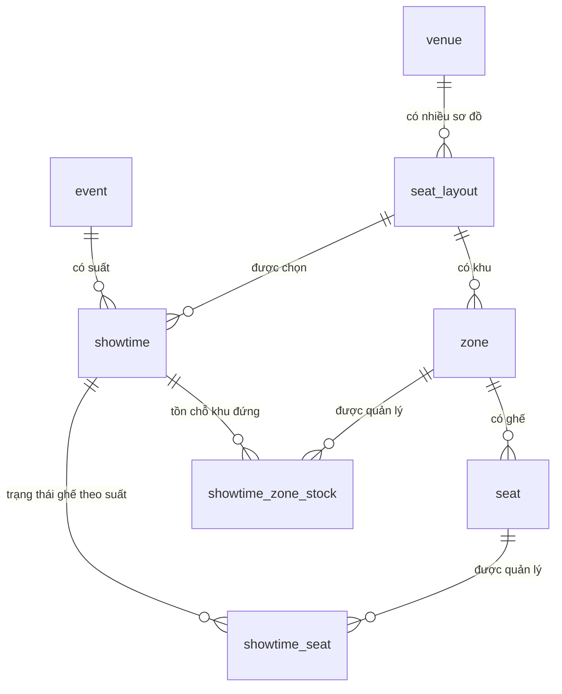

# Kế hoạch loại bỏ hall

**Cập nhật local 16/11/2026, 23:06:** đã migrate DB local và kiểm tra bảo toàn dữ liệu; xem [biên bản migrate local](local-venue-v2-migration.md). Các ghi chú chưa áp dụng DB local trong phần chuẩn bị/kiểm tra bên dưới mô tả thời điểm trước lần migrate này. UI và staging/production chưa triển khai.

## Mục tiêu

Đơn giản hóa mô hình cho sản phẩm phục vụ sân vận động. Một sân có nhiều sơ đồ phục vụ bóng đá, concert hoặc cách bố trí khác. Mỗi sơ đồ có nhiều zone; zone ngồi có ghế, zone đứng quản lý sức chứa.

Đã có migration chờ (1.2) và triển khai contract/backend (1.3), xem [venue-import-api.md](venue-import-api.md). UI và schema DB local chưa chuyển đổi; PR review/triển khai/nghiệm thu còn ở checklist.

Luồng nhập sân được cập nhật theo [venue-import-flow.md](venue-import-flow.md): SVG tổng quát → tên/loại layout và SVG zone/ghế → mapping/preview → thông tin còn lại → lưu/phát hành. Phần này mở rộng schema ngoài việc bỏ hall.

## Checklist triển khai

### A. Chuẩn bị migration — mục 1.2

- [x] Rà soát quan hệ và constraint hiện tại của `hall`, `seat_layout`, `showtime`.
- [x] Chốt quan hệ bỏ hall: `seat_layout.venue_id`, bỏ `showtime.hall_id`, bỏ bảng `hall`.
- [x] Chốt schema SVG tổng quát, vùng nền, cổng, loại layout và mapping; xem `venue-schema-v2.md`.
- [x] Soạn migration SVG nhiều lớp chờ 1910, giữ layout cũ ở dạng legacy, có kiểm tra SQL/Flyway riêng.
- [x] Soạn SQL tại `deploy/migrations-pending/V20261116_1900__catalog_remove_hall.sql`, ngoài đường dẫn Flyway tự chạy.
- [x] Thêm preflight từ chối showtime/layout lệch hall và phiên bản layout bị trùng trong sân.
- [x] Giữ nguyên ID, tên, version layout và các liên kết đơn hàng/vé; không thêm constraint tên layout duy nhất.
- [x] Bọc triển khai trong transaction, khóa bảng khi chuyển đổi; không dùng `DROP ... CASCADE`.
- [x] Kiểm tra migration trên PostgreSQL 18 riêng với nhiều hall/layout/showtime.
- [x] Kiểm tra dữ liệu lệch bị từ chối và transaction rollback giữ nguyên schema/dữ liệu cũ.
- [x] Kiểm tra FK, NOT NULL, unique version theo sân và dữ liệu nghiệp vụ sau chuyển đổi.
- [x] Ghi kết quả kiểm tra và giới hạn xác minh.

### B. Contract API — mục 1.3

- [x] Bỏ API/model tạo và liệt kê hall; bỏ `Venue.halls`.
- [x] Chuyển liệt kê sơ đồ sang `/admin/venues/{venue_id}/seat-layouts`; import qua `/admin/venue-imports` để lưu nháp nhiều phiên.
- [x] Thiết kế API SVG tổng quát/cổng, loại layout và mapping/preview; chốt cách lưu wizard từ file trước thông tin sân sau.
- [x] Đổi `hall_id` của model layout thành `venue_id`; bỏ `hall_id` của showtime.
- [x] Bỏ `HALL_NAME_TAKEN`, cập nhật mô tả/lỗi/ví dụ và sinh lại code.
- [ ] Review contract qua PR theo quy định repo.

### C. Backend — mục 1.3

- [x] Catalog: sơ đồ trực thuộc sân, bỏ tạo/chọn hall.
- [x] Tách parser SVG nền và SVG chi tiết; lưu phiên bản nền, cổng, vùng mapping và loại layout.
- [x] Showtime: chọn layout PUBLISHED; suy ra sân qua layout.
- [x] Kiểm tra sân hoạt động và chặn xóa sân còn suất chưa kết thúc.
- [x] Search: đổi SQL join, kết quả tìm kiếm và mapper.
- [x] Booking, ticketing: đổi SQL đọc thông tin sân trong đơn/vé.
- [x] Notifications: bỏ thông tin hall trong email vé.
- [x] Cập nhật fixture, test schema, test migration lịch sử và test API bị ảnh hưởng.

### D. Frontend — đợt tiếp theo

- [ ] Đồng bộ phần contract thay đổi và sinh lại client.
- [ ] Bỏ bước tạo/chọn hall; quản lý nhiều layout trực tiếp trên sân.
- [ ] Đổi wizard: SVG tổng quát → tên/loại layout + SVG zone/ghế → map/preview → thông tin sân → lưu/phát hành.
- [ ] Thay route/màn hình/hook/query key hiện dùng hall.
- [ ] Showtime: chọn sân → layout đã phát hành; đổi sân phải xóa lựa chọn layout cũ.
- [ ] Cập nhật mock, thông báo lỗi, nhãn giao diện và test.

### E. Áp dụng DB và nghiệm thu — sau khi B, C, D hoàn tất

- [ ] Chốt migration version thực tế, tránh trùng thứ tự với migration phát sinh trong thời gian chờ.
- [ ] Sao lưu DB, xác nhận khôi phục được và thống kê dữ liệu trước chuyển đổi.
- [ ] Ngừng backend/worker phiên bản cũ, chạy preflight trên DB đích.
- [ ] Chuyển SQL đã kiểm tra vào `src/main/resources/db/migration/`, triển khai đồng bộ backend/frontend.
- [ ] Flyway migrate DB đích trong transaction; đối chiếu schema, số lượng bản ghi và ID/liên kết sau migrate.
- [ ] Chạy kiểm tra frontend, `./mvnw verify` và kiểm tra luồng tạo sân → sơ đồ → showtime → đặt vé.
- [ ] Cập nhật tài liệu kiến trúc, search và hướng dẫn trong `CLAUDE.md`.

Không đánh dấu đã sửa DB local khi mới soạn hoặc thử migration trong môi trường riêng.

### Kết quả kiểm tra migration

Chạy `python scripts/check_remove_hall_migration.py`: đạt 6 nhóm kiểm tra trên container PostgreSQL 18 riêng, không publish port và không kết nối DB local:

1. Gộp layout từ nhiều hall về sân, cho phép tên layout trùng; đối chiếu nguyên vẹn dữ liệu layout/version, zone, ghế, showtime, đơn, vé, tồn chỗ và thanh toán.
2. Khóa ngoại `venue_id`, NOT NULL và UNIQUE `(venue_id, version)` được thực thi.
3. Showtime/layout lệch hall bị từ chối và rollback.
4. Version layout trùng trong cùng sân bị từ chối và rollback.
5. Dependency ngoài dự kiến làm `DROP TABLE hall` thất bại; mọi thay đổi trước đó rollback, giữ hall_id, constraint và index cũ.
6. Schema chưa có dữ liệu vẫn chuyển đổi được.

Runner áp dụng các SQL migration hiện tại để dựng schema gốc, sau đó chạy SQL chờ trong transaction bằng psql; đây chưa phải kiểm tra triển khai Flyway/app hoàn chỉnh. Container tạm được dọn sau khi chạy.

`./mvnw verify` vẫn bị chặn bởi phần `VenuePlaceLookupService` đang dở và hai client rỗng trong workspace, như đã ghi ở đợt auth. Chưa xác nhận build toàn repo hoặc áp dụng trên DB local. Migration bổ sung SVG nền/cổng/loại layout đã soạn ở file chờ 1910; thiết kế và kết quả kiểm tra riêng tại `venue-schema-v2.md`.

## 1. Mô hình dữ liệu đích



- `seat_layout.venue_id` thay thế `seat_layout.hall_id`.
- `showtime` giữ `event_id`, `seat_layout_id`, thời gian và trạng thái; bỏ `hall_id`.
- Sân của suất diễn được xác định qua `showtime → seat_layout → venue`, không thêm `showtime.venue_id`.
- Giữ các bảng `zone`, `seat`, `showtime_seat`, `showtime_zone_stock` và cấu trúc đơn hàng, thanh toán, vé.
- Mỗi showtime chọn một phiên bản sơ đồ `PUBLISHED`; sơ đồ đã phát hành vẫn bị khóa.
- Bóng đá và concert có tên layout và trường loại layout riêng. Schema SVG nền/cổng/mapping và loại layout được chốt trong `venue-schema-v2.md`, đã có migration chờ 1910; SQL bỏ hall 1900 không tạo các phần đó.
- Giữ cơ chế số phiên bản hiện tại; không đổi sang đánh số lại theo sân trong đợt chuyển đổi.

Ví dụ:

```text
Sân Mỹ Đình
├── Sơ đồ bóng đá
│   ├── Khán đài A → các ghế
│   └── Khán đài B → các ghế
└── Sơ đồ concert
    ├── VIP dưới sân → các ghế
    └── Khu đứng → sức chứa
```

Showtime là một lần tổ chức cụ thể của sự kiện. Hai showtime có thể dùng cùng sơ đồ nhưng có trạng thái ghế và tồn chỗ độc lập.

## 2. Cập nhật contract API trước

Nguồn contract: `contracts/vingo-openapi.yaml`.

| Thành phần hiện tại | Thay đổi |
|---|---|
| `POST /admin/venues/{venue_id}/halls` | Loại bỏ |
| `/admin/halls/{hall_id}/seat-layouts` | Chuyển thành `/admin/venues/{venue_id}/seat-layouts` |
| `/admin/halls/{hall_id}/seat-layouts/import` | Chuyển thành `/admin/venues/{venue_id}/seat-layouts/import` |
| Model `Hall`, request tạo hall | Loại bỏ khi không còn tham chiếu |
| `SeatLayout.hall_id` và các model sơ đồ liên quan | Thay bằng `venue_id` |
| Input/output showtime có `hall_id` | Loại bỏ; dùng `seat_layout_id` |
| Danh sách halls trong thông tin sân | Loại bỏ |
| Lỗi `HALL_NAME_TAKEN` | Loại bỏ khỏi contract và code khi không còn dùng |

- Giữ các endpoint theo `layout_id`, gồm chi tiết và phát hành sơ đồ.
- Cập nhật operation description, ví dụ, schema và lỗi để frontend/agent hiểu đúng luồng mới.
- Sinh lại interface/model backend bằng `generate-sources`; không sửa file sinh trong `target/generated-sources`.
- Sinh lại API client frontend theo quy trình của repo frontend.
- Thay đổi contract phải qua PR, Đức duyệt theo `CLAUDE.md`.

## 3. Migration và bảo toàn dữ liệu

Tạo migration Flyway mới theo quy ước repo. Không sửa migration lịch sử, không reset database.

### Kiểm tra trước chuyển đổi

- Thống kê số sân, hall, layout, showtime, zone, ghế, đơn và vé.
- Kiểm tra `showtime.hall_id` có khớp hall của `seat_layout_id` hay không.
- Nếu có dữ liệu lệch, dừng chuyển đổi và xác định cách xử lý cụ thể; không tự gán lại sân.
- Lưu ý nhiều hall của một sân sẽ được gộp vào một danh sách layout; tên layout có thể giống nhau. Không tự thêm constraint tên layout duy nhất theo sân.

### Thứ tự chuyển đổi

1. Thêm cột `seat_layout.venue_id` cho phép null tạm thời.
2. Điền dữ liệu bằng quan hệ `seat_layout.hall_id → hall.venue_id`.
3. Kiểm tra không có layout thiếu sân hoặc trỏ tới sân không hợp lệ.
4. Thêm khóa ngoại, đặt `NOT NULL`, tạo index theo `venue_id`.
5. Thay constraint `(hall_id, version)` bằng `(venue_id, version)` sau khi kiểm tra tính duy nhất; giữ nguyên giá trị version hiện có.
6. Bỏ khóa ngoại/cột `showtime.hall_id` và các constraint/index phụ thuộc.
7. Bỏ khóa ngoại/cột `seat_layout.hall_id` và các constraint/index phụ thuộc.
8. Bỏ bảng `hall` sau khi không còn tham chiếu.

Giữ nguyên ID của venue, layout, zone, seat, showtime và các bảng giao dịch để đơn hàng, vé và lịch sử tiếp tục tham chiếu đúng.

### Cách đưa vào sử dụng

- Đây là thay đổi phá vỡ API và schema cũ; kế hoạch mặc định là cập nhật backend/frontend đồng bộ trong một đợt có thời gian bảo trì.
- Sao lưu database trước khi áp dụng; ngừng phiên bản backend/worker cũ trước khi chạy migration phá vỡ schema.
- Nếu cần khôi phục, dùng bản sao lưu cùng phiên bản ứng dụng tương ứng. Không giả định có thể dựng lại hall sau khi đã xóa.
- Nếu sau này có yêu cầu không gián đoạn dịch vụ, cần thiết kế riêng lộ trình thêm cột, chạy tương thích rồi mới xóa cột cũ.

## 4. Backend

| Phần | Công việc |
|---|---|
| `VenueService`, `VenueRepository`, `AdminVenueController` | Bỏ tạo/liệt kê hall và dữ liệu halls trong response |
| `SeatLayoutImportService`, `SeatLayoutRepository` | Import, tạo, đọc và liệt kê layout theo sân; kiểm tra sân còn hoạt động |
| Showtime | Bỏ hall khỏi DTO và SQL; kiểm tra layout tồn tại, đã phát hành và thuộc sân còn hoạt động |
| Quản lý sân | Kiểm tra suất chưa kết thúc qua `showtime → seat_layout → venue` khi xóa sân |
| `EventRepository`, `EventPublishingRepository`, `EventDetails` | Bỏ join và dữ liệu hall, giữ đúng thông tin sân |
| Search | Cập nhật truy vấn tìm kiếm, chi tiết sự kiện, showtime và mapper |
| Booking | Cập nhật truy vấn đọc địa điểm trong đơn |
| Ticketing | Cập nhật truy vấn thông tin địa điểm trên vé |
| Notifications | Bỏ thông tin hall trong email, hiển thị sân và khu/ghế phù hợp |

Đã tìm thấy phụ thuộc trong catalog, search, booking, ticketing và notifications. Theo `CLAUDE.md`, báo chủ module trước khi sửa module của người khác; phần booking/payment liên quan phải tuân thủ quy định review của repo.

Không thay đổi quy tắc giữ ghế, chốt thanh toán hoặc phát hành vé chỉ vì loại bỏ hall.

## 5. Frontend

Repo frontend hiện tại: `../vingo-web`.

Trước khi triển khai frontend, đọc các hướng dẫn áp dụng trong repo đó.

### Luồng tạo sân mới

```text
Import SVG tổng quát: hình sân, vùng khán đài, cổng
    → Nhập tên/loại layout, import SVG zone và ghế chi tiết
    → Map và preview trên sơ đồ tổng quát
    → Nhập thông tin sân và các thông tin còn lại
    → Kiểm tra, lưu và phát hành
```

- Bỏ ô tạo/chọn hall trong `VenueWizardPage`.
- Thay màn hình `HallLayoutsPage` bằng màn hình quản lý sơ đồ theo sân.
- Bỏ hoặc thay `VenueHalls`, route `halls/:hallId/layouts`, query key và hook dùng hall.
- Danh sách sân hiển thị số sơ đồ/thông tin sẵn sàng thay vì số hall.
- Form showtime dùng thứ tự chọn sân → sơ đồ đã phát hành → thời gian.
- Khi đổi sân, xóa lựa chọn sơ đồ cũ để tránh gửi layout của sân trước.
- Khi sửa showtime, suy ra sân từ layout hiện tại để điền form.
- Cập nhật các trang chi tiết sự kiện, mock API, mock data, thông báo lỗi và nhãn giao diện còn hall.
- Giữ khả năng có nhiều layout trên một sân và chọn đúng layout cho từng showtime.

## 6. Kiểm tra

- [ ] Migration chạy trên dữ liệu cũ có nhiều hall, layout và showtime.
- [ ] Phát hiện dữ liệu showtime/layout lệch hall trước khi xóa quan hệ cũ.
- [ ] Giữ nguyên ID, số lượng bản ghi nghiệp vụ, đơn hàng và vé sau migration.
- [ ] Một sân tạo/import được nhiều layout, mỗi layout có zone và ghế riêng.
- [ ] Chỉ import layout vào sân hợp lệ, còn hoạt động.
- [ ] Showtime chọn được layout `PUBLISHED`, bị từ chối với layout `DRAFT`.
- [ ] Đổi sân trên UI làm mất lựa chọn layout cũ.
- [ ] Hai showtime cùng layout có trạng thái ghế và tồn chỗ độc lập.
- [ ] Xóa sân vẫn bị chặn nếu còn suất chưa kết thúc theo quy tắc hiện tại.
- [ ] Tìm kiếm, chi tiết sự kiện, đơn hàng, vé và email trả đúng sân.
- [ ] Phân quyền quản trị không thay đổi.
- [ ] Cập nhật fixture, test schema, test migration và test tích hợp bị ảnh hưởng.
- [ ] Không còn phụ thuộc hall trong code hoạt động, contract, API client và UI; giữ nguyên migration lịch sử.
- [ ] Chạy kiểm tra frontend phù hợp và `./mvnw verify` của backend.

## 7. Tài liệu và review

- Cập nhật `docs/architecture.html`, `docs/search.html` và các ví dụ còn dùng hall.
- Cập nhật bảng lỗi và hướng dẫn liên quan trong `CLAUDE.md` nếu loại bỏ `HALL_NAME_TAKEN`.
- Chia phần review: contract/schema, backend, frontend; chỉ đưa vào sử dụng khi cả ba khớp nhau.
- Trong thời gian triển khai, có thể có commit chưa tương thích nhau; không triển khai riêng phần migration phá vỡ schema với ứng dụng cũ.

## 8. Điều kiện hoàn tất

Admin tạo sân và quản lý nhiều sơ đồ trực tiếp, không còn thao tác với hall. Showtime chọn một sơ đồ đã phát hành và xác định sân qua sơ đồ đó. Dữ liệu cũ được giữ nguyên liên kết, các luồng đặt vé/thanh toán/soát vé hoạt động đúng và các kiểm tra bắt buộc đều đạt.
