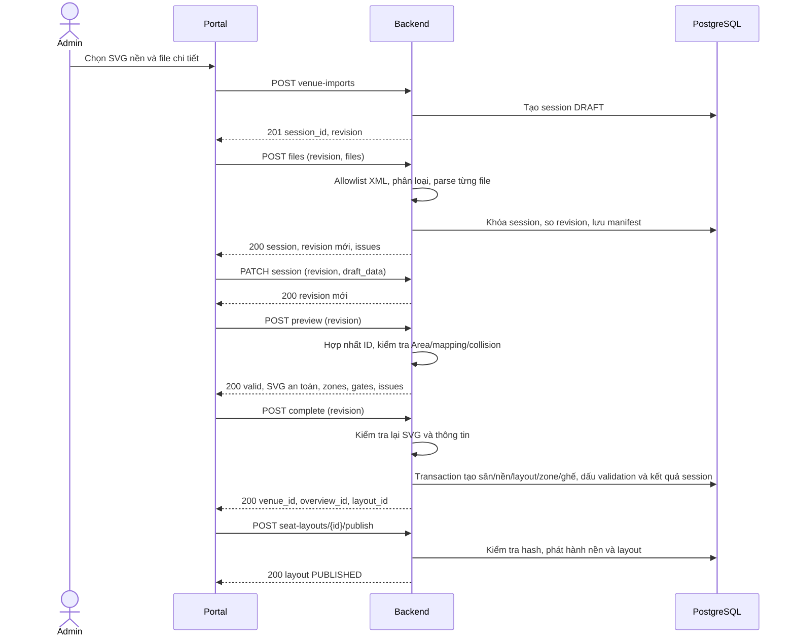

# Backend nhập sân v2 — mục 1.3

**Cập nhật local 16/11/2026, 23:06:** đã migrate DB local và kiểm tra bảo toàn dữ liệu; xem [biên bản migrate local](local-venue-v2-migration.md). Các ghi chú chưa áp dụng DB local trong phần chuẩn bị/kiểm tra bên dưới mô tả thời điểm trước lần migrate này. UI và staging/production chưa triển khai.

Backend dùng `venue → venue_overview / seat_layout → zone → seat`, không còn đọc hoặc ghi `hall`. Contract ở `contracts/vingo-openapi.yaml`; UI wizard là mục 1.4, chưa được thay đổi trong đợt này.

## Chuỗi API

Tất cả đường dẫn dưới đây có tiền tố `/api/v1`, yêu cầu token ADMIN. Phiên nhập thuộc riêng admin tạo phiên; admin khác nhận 404. Không gửi bytes SVG thô vào DOM của trình duyệt.

| Bước | API | Đầu vào / kết quả |
|---|---|---|
| Tạo nháp | `POST /admin/venue-imports` | `{}` cho sân mới; `{target_venue_id}` để thêm layout; có thể thêm `overview_id` của nền PUBLISHED cùng sân. Trả **201**, session, revision, expiry; chưa tạo sân rỗng. |
| Mở lại | `GET /admin/venue-imports/{id}` | Trả **200**, draft_data, manifest, SVG đã qua allowlist nếu có, lỗi file, revision và kết quả đã hoàn tất. |
| Danh sách nháp | `GET /admin/venue-imports?cursor=&limit=20` | Chỉ nháp DRAFT còn hạn của mình; cursor UUID giảm dần, không đưa SVG vào trang danh sách. |
| Upload | `POST /admin/venue-imports/{id}/files` | Multipart `revision` và một/nhiều `files`, MIME `image/svg+xml`. Trả **200** session mới; file sai hình học vẫn lưu với INVALID/issues. Trùng checksum không thêm bản ghi. |
| Bỏ file | `DELETE /admin/venue-imports/{id}/files/{file_id}?revision=...` | Trả **200** session mới. Không được xóa nền nguồn đã chọn bằng overview_id. |
| Lưu wizard | `PATCH /admin/venue-imports/{id}` | `{revision, step?, draft_data?}`. `draft_data` thay thế toàn bộ cấu hình do client quản lý. Trả **200**, revision mới. |
| Ghép / kiểm tra | `POST /admin/venue-imports/{id}/preview` | `{revision}`; trả **200**, `valid`, `issues`, SVG nền/chi tiết hợp nhất nếu hợp lệ, zone preview, cổng, AREA và `zone_areas`. Không tạo dữ liệu sân. |
| Hoàn tất | `POST /admin/venue-imports/{id}/complete` | `{revision}`; kiểm tra lại metadata/SVG/mapping, lưu nguyên tử, trả **200** `{venue_id, overview_id, layout_id}`. Layout vẫn DRAFT. Retry session COMPLETED trả cùng IDs, kể cả revision cũ. |
| Hủy | `POST /admin/venue-imports/{id}/cancel` | `{revision}`; trả **200** session CANCELLED. Gửi lại trả cùng trạng thái. |
| Phát hành | `POST /admin/seat-layouts/{layout_id}/publish` | Chỉ phát hành layout v2 đã có dấu validation đúng với dữ liệu hiện tại; phát hành nền tương ứng trước. Trả **200** layout PUBLISHED; gọi lại giữ nguyên thời điểm phát hành. |
| Xem nền | `GET /admin/venues/{venue_id}/overviews`, `GET /admin/venue-overviews/{overview_id}` | Danh sách có cursor; chi tiết có SVG an toàn, viewBox, cổng và AREA. |
| Chọn layout | `GET /admin/venues/{venue_id}/seat-layouts?layout_type=FOOTBALL&status=PUBLISHED` | Trả layout cùng sân/loại. `include_legacy=false` mặc định; model có venue_id, overview_id, layout_type, legacy. |

Luôn dùng **revision trong response**, không tự tăng một đơn vị: một upload nhiều file có thể tăng revision nhiều lần do trigger DB. Revision cũ/phiên đóng trả 409 `ACTION_STATE_INVALID`, kèm `current_revision`. Phiên khác chủ/hết hạn/không tồn tại trả 404. File quá giới hạn trả 413 `PAYLOAD_TOO_LARGE`; MIME sai trả 415 `UNSUPPORTED_MEDIA_TYPE`. Lỗi metadata trả 400; hoàn tất với SVG chưa hợp lệ trả 422 `INVALID_SEAT_LAYOUT` và `issues`.

Ví dụ lưu thông tin trước khi hoàn tất sân mới:

```json
{
  "revision": 3,
  "step": "REVIEW",
  "draft_data": {
    "overview_name": "Nền sân chính",
    "layout_name": "Bóng đá tiêu chuẩn",
    "layout_type": "FOOTBALL",
    "zone_areas": {"A-T1": "STAND-A"},
    "venue": {
      "name": "Sân vận động",
      "type": "STADIUM",
      "address": "Địa chỉ sân",
      "city": "HN"
    }
  }
}
```

`valid` của preview xác nhận hình học/mapping; thông tin sân, tên và loại layout được kiểm tra khi complete.

`zone_areas` ánh xạ **mã zone → mã AREA**, không dùng UUID của preview. Zone preview chưa có UUID DB; dùng `code`/`svg_id` để tương tác. Sau khi lưu, API chi tiết zone có `overview_area_id`. Nếu nền không khai báo AREA thì không cần mapping. Nếu đúng một AREA chứa toàn bộ hình zone, server tự gán; có nhiều lựa chọn thì admin phải chọn rõ. Phiên thêm layout vào sân đã có không sửa metadata sân; dùng API sửa sân riêng. `overview_id` được gắn khi tạo phiên và do server giữ, không cho client đổi giữa phiên.



## Quy tắc xử lý SVG

- Một overview, ít nhất một detail; mọi file có cùng viewBox số học `0 0 W H`. Chỉ FOOTBALL/CONCERT. Phân loại bằng marker DOM, không dựa tên file; marker nghiệp vụ trong defs/mask bị từ chối.
- Overview cần ít nhất một GATE, không chứa ZONE/SEAT. Gate ID nhận hướng IN/OUT/BOTH; thiếu hướng là BOTH. Detail không chứa PITCH/GATE/AREA/WALKWAY. Quy ước chi tiết tại `svg-v2-conventions.md`.
- COMBINED_V1 nhận diện được nhưng báo `COMBINED_REQUIRES_SPLIT`; admin phải xuất riêng các lớp. Backend không tự cắt tùy ý file Figma.
- Chặn DOCTYPE, script, processing instruction, event handler, style và tài nguyên ngoài. Use/defs/mask/fill-rule/transform chỉ dùng tập hình học đã hỗ trợ; phần còn lại báo lỗi rõ. Không có `sanitized_svg` nếu chưa qua allowlist đầy đủ.
- Ghép file giữ nguyên ID nghiệp vụ; technical ID được thêm tiền tố theo file, tránh cả ID đã có trong nền, đồng thời sửa href/mask cục bộ. Mã trùng giữa file bị chặn.
- Hình zone và toàn bộ diện tích ghế phải trong viewBox; ghế phải trong zone; zone phải trong AREA đã chọn nếu có. Kiểm tra zone–zone và seat–seat theo diện tích thực (sai số số học `1e-8` đơn vị²), cho phép chạm biên.
- Zone–gate dùng diện tích thực có winding/cutout, ngưỡng **0.5 đơn vị tọa độ²**. Ghế giao diện tích cổng hoặc có tâm trong cổng bị chặn; không suy luận từ bounding box.
- File nguồn tối đa **10 MiB**, request tối đa **10 MiB** nguồn / **32 file**; một session tối đa **32 file / 40 MiB** nguồn. Detail sau hợp nhất tối đa 10 MiB. Giới hạn 100.000 phần tử mỗi file. Có thể upload qua nhiều request.
- Preview lỗi trả issues; có thể xem SVG an toàn từng file qua GET session, không dùng bytes nguồn để hiển thị. Hình học được xử lý trước transaction ghi; revision được kiểm tra lại khi khóa session để không lưu kết quả đã cũ.

### Fixture Thiên Trường

File gốc `sources/LAYOUT__THIEN-TRUONG.svg` vẫn giữ nguyên: COMBINED_V1, 27 zone, 6.699 ghế, 17 cổng. Test collision cổng với hình học thực vẫn được giữ. Khi tách lớp để kiểm tra đầy đủ theo quy tắc v2, validator phát hiện `ZONE__A6-T1__SEATED` giao zone `C5-T1`, nên không mặc định coi file gốc đủ điều kiện hoàn tất v2. Test HTTP luồng thành công dùng mẫu độc lập, hợp lệ, 2 zone/4 ghế; không sửa fixture gốc để ép test xanh.

## Dữ liệu, thời hạn và phát hành

Raw SVG lưu bytea trong bảng file nháp; API không trả raw bytes. Hoàn tất lưu sân, phiên bản nền, cổng, AREA, layout, SVG hợp nhất, zone/mapping và ghế cùng kết quả session trong một transaction. Lỗi ở giữa rollback toàn bộ; hai request hoàn tất đồng thời nhận cùng kết quả đã lưu.

Dấu `validation_hash` được tính từ dữ liệu DB sau khi validator đã kiểm tra; client không được cung cấp dấu này. Thay nội dung sẽ làm dấu cũ hết hiệu lực. Layout/nền đã phát hành và các bảng con bị DB khóa chỉnh sửa. Đổi tên DRAFT chỉ bảo toàn dấu nếu dữ liệu trước đổi tên còn được xác nhận hợp lệ. Cần đổi hình học bản đã phát hành thì tạo phiên bản mới.

Nháp có TTL trượt 30 ngày; COMPLETED/CANCELLED giữ 7 ngày để mở lại/thử lại. Worker chạy cleanup mỗi 5 phút, dùng Clock, ShedLock và `FOR UPDATE SKIP LOCKED`, tối đa 20 lô × 100 session mỗi lượt, cascade file theo session. Không gọi HTTP ra ngoài khi giữ khóa.

Showtime chỉ nhận `seat_layout_id` cùng các mốc thời gian; venue được suy ra từ layout. Không nhận hall_id. Chỉ layout v2 PUBLISHED được gắn mới. Layout legacy vẫn đọc/xuất và giữ liên kết của showtime cũ; không tự suy đoán loại/nền. Mỗi showtime khởi tạo `showtime_seat` và `showtime_zone_stock` riêng.

## Chạy thử và triển khai

Các SQL sân v2 đã nằm trong `src/main/resources/db/migration` và được Flyway tự áp khi API khởi động; sao lưu DB trước lần chạy đầu vì migration bỏ hall không quay ngược được. Test áp dụng chúng như mọi migration khác trên PostgreSQL Testcontainers.

Profile `venue-v2` đã bỏ vì không còn cần. Khi triển khai lên staging/production, triển khai đồng bộ backend và UI theo mục 1.5. Worker chỉ khởi động sau khi schema mới đã được API/Flyway áp dụng.

Contract còn cần PR review theo CLAUDE.md và nghiệm thu Swagger staging; không đánh dấu hai việc đó đã xong từ kết quả test local.

## Kết quả xác minh ngày 16/11/2026

- 870 test đạt, 0 failure/error/skipped trên Linux, Java 25 và PostgreSQL 18 Testcontainers, từ bản build sạch. Bao gồm 21 test import session mới, 14 test xử lý SVG v2, 21 test API layout đã cập nhật, 2 test Flyway và các test phân module.
- Bài tải gốc giữ nguyên 1.000 request cùng start barrier, không retry hoặc giảm tải: đúng 1 phản hồi 201, 999 phản hồi 409, một đơn PENDING và một ghế HELD. Khi chạy cả bộ trên Windows có lỗi kết nối ở bài này; không thay đổi bài test để bỏ qua lỗi. Cấu hình/client thử nghiệm riêng đã được gỡ, giữ nguyên test gốc và các assertion.
- Sáu nhóm kiểm tra SQL riêng trong `scripts/check_venue_schema_migration.py` đều đạt: dữ liệu legacy, schema mới, FK/publication/hash, nháp/revision/TTL, quota và rollback.
- `mvnw verify` chuẩn đã chạy nhưng bị chặn ở compile bởi `VenuePlaceLookupService` tham chiếu các lớp Google Places/Gemini còn viết dở trong workspace. Giữ nguyên những file đó. Để kiểm tra hồi quy phần thay đổi, dùng POM tạm chỉ loại `VenuePlaceLookupService.java` khỏi compile, không loại hoặc skip test; chạy `clean verify` trong container Linux với toàn bộ bộ test. Đây là kết quả kiểm tra có điều kiện, không phải xác nhận verify chuẩn toàn workspace đã đạt.
- Không chạy migration trên DB local, không triển khai UI hoặc staging. PR review contract và nghiệm thu tích hợp vẫn còn trong checklist.
