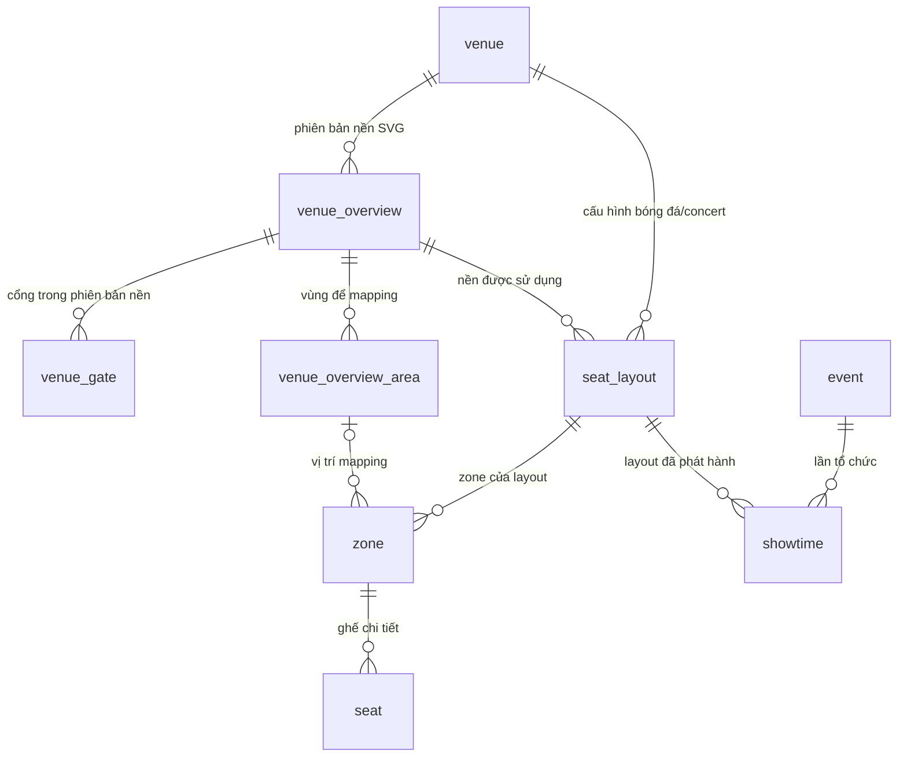

# Luồng nhập sân và sơ đồ mới

**Cập nhật local 16/11/2026, 23:06:** đã migrate DB local và kiểm tra bảo toàn dữ liệu; xem [biên bản migrate local](local-venue-v2-migration.md). Các ghi chú chưa áp dụng DB local trong phần chuẩn bị/kiểm tra bên dưới mô tả thời điểm trước lần migrate này. UI và staging/production chưa triển khai.

## Phạm vi

Đặc tả luồng thay thế cho bước tạo sân hiện tại. Backend/API nhập nhiều file và session đã triển khai ở mục 1.3, xem [venue-import-api.md](venue-import-api.md); wizard UI còn ở mục 1.4. Schema SVG nhiều lớp đã có migration chờ và kiểm tra, xem `venue-schema-v2.md`. DB local chưa đổi theo thiết kế này. Phần collision SVG và contract lỗi đã được bổ sung riêng, xem mục 3.1–3.2 của `svg-v2-conventions.md`.

Các quyết định mới về FOOTBALL/CONCERT, nhiều file, tọa độ chung, nháp qua nhiều phiên và zone/cổng độc lập được cập nhật trong [svg-v2-conventions.md](svg-v2-conventions.md). Quy ước kỹ thuật trong file đó thay thế các lựa chọn cũ tương ứng bên dưới.

## Bước 1 — Import SVG tổng quát

Admin tải SVG mô tả hình dạng sân, các vùng khán đài/chỗ ngồi xung quanh và cổng ra/vào. UI hiển thị preview ngay để kiểm tra file trước khi nhập thông tin sân.

- Đây là lớp nền hình học của sân, chưa phải danh sách ghế có thể bán.
- Phân tích viewBox, hình dạng vùng và mã cổng; hiển thị lỗi nếu trùng mã hoặc không đọc được. Cổng có tên hiển thị và hướng sử dụng vào, ra hoặc cả hai.
- Quy ước đề xuất: `AREA__A`, `AREA__B` cho vùng nền; `GATE__G1`, `GATE__G2` cho cổng. Nhãn hiển thị có thể khác mã.
- Làm sạch SVG và chặn script, event handler, liên kết/tài nguyên bên ngoài trước khi preview và trước khi lưu.
- Sơ đồ tổng quát có phiên bản; thay nền không làm biến đổi sơ đồ layout đã phát hành.

Kết quả bước này là bản nháp SVG tổng quát và danh sách vùng/cổng đã nhận diện. Không tự tạo zone bán vé hoặc ghế từ các hình nền.

## Bước 2 — Tạo seat_layout, import zone và ghế chi tiết

Admin nhập tên layout và chọn loại, ví dụ:

| Tên | Loại |
|---|---|
| Bóng đá tiêu chuẩn | FOOTBALL |
| Concert sân khấu phía Bắc | CONCERT |

Loại layout độc lập với tên và version; phạm vi đầu tiên chốt FOOTBALL và CONCERT. Mỗi layout thuộc một sân và tham chiếu đúng phiên bản SVG tổng quát của sân đó.

- Hỗ trợ nhiều file SVG chi tiết cho một layout; một bộ có đúng một overview và một hoặc nhiều file zone/ghế, cùng hệ tọa độ. Phân loại và hợp nhất theo `svg-v2-conventions.md`, không đoán dựa tên file.
- Zone ngồi có mã zone, tên, hình dạng và danh sách ghế/hàng/số ghế.
- Zone đứng có hình dạng và sức chứa, không tạo ghế giả.
- Các mã zone/ghế phải ổn định và không trùng trong phạm vi quy định.
- Tên và loại layout là dữ liệu bắt buộc trước khi hoàn tất cấu hình layout.

## Bước 3 — Map và preview trên sơ đồ tổng quát

UI ghép hai lớp:

```text
SVG tổng quát: biên sân + vùng nền + cổng ra/vào
                       +
SVG layout chi tiết: hình zone + ghế / khu đứng
                       ↓
Preview hoàn chỉnh của layout đang chọn
```

- Mỗi zone chi tiết được gắn vào vùng tương ứng của SVG tổng quát; cùng một vùng nền có thể chứa nhiều zone của layout.
- Ghép qua mã vùng/mapping được xác nhận, không đoán theo tên hiển thị hoặc màu.
- Ghép trực tiếp theo cùng hệ tọa độ và viewBox chuẩn hóa. Không hỗ trợ kéo/xoay/căn chỉnh thủ công; file lệch phải báo lỗi, không tự scale để sửa. Transform có sẵn trong file vẫn phải được parser xử lý chính xác hoặc từ chối rõ.
- Ghế nằm trong zone, zone nằm đúng vị trí dự kiến; cổng vẫn lấy từ lớp nền. Admin kiểm tra các vị trí này trên preview.
- Khu dưới sân dành cho concert có thể cần vùng nền riêng; không ép ghép vào khán đài bóng đá.
- Preview cho phép bật/tắt lớp nền, zone, ghế và cổng; chọn zone để xem số ghế hoặc sức chứa, xem trạng thái mapping.
- Chặn hoàn tất nếu thiếu mapping bắt buộc, mã trùng, tọa độ sai hoặc parser không đọc được cấu trúc.

Giá vé không đặt ở bước này: giá/hạng giá vẫn được cấu hình theo sự kiện như mô hình hiện tại.

## Bước 4 — Nhập thông tin tương ứng còn lại

Sau khi preview đúng, admin bổ sung:

- Tên sân, địa chỉ, tỉnh/thành, quận/huyện, tọa độ và thông tin tiện ích/quy định.
- Tên hiển thị các vùng/cổng, thông tin khu/ghế còn thiếu và sức chứa khu đứng.
- Zone và cổng độc lập, không gán quan hệ nghiệp vụ giữa hai phần. Kiểm tra hình học bảo đảm zone/ghế không chiếm vùng cổng, không tính nhãn cổng vào collision.

Nếu cần sửa tên hoặc loại layout, admin có thể quay lại bước cấu hình trước đó. UI phải giữ dữ liệu và file đã chọn trong phiên wizard.

## Bước 5 — Kiểm tra, lưu và phát hành

Admin xem lại thông tin sân, tên/loại layout, số khu, số ghế, sức chứa khu đứng, cổng và preview cuối trước khi lưu. Sau khi cấu hình hợp lệ có thể phát hành layout để dùng cho showtime.

Không tạo bản ghi venue rỗng chỉ để upload SVG: DB hiện bắt buộc tên sân. Chốt lưu nháp qua nhiều phiên bằng import session phía server; có chủ sở hữu, revision và cơ chế mở lại/cleanup. API nháp và nơi lưu đã triển khai theo venue-import-api.md, không nới constraint tên sân.

API complete của session thực hiện transaction tổng hợp theo venue-import-api.md. Khi ghi DB, thông tin sân, nền, layout, zone và ghế phải có chiến lược transaction rõ; không đánh dấu hoàn tất nếu mới lưu được một phần.

## Quan hệ DB đề xuất



Schema chi tiết, nullability/mapping, constraint và chính sách legacy đã chốt tại [venue-schema-v2.md](venue-schema-v2.md). Migration chờ đã được kiểm tra riêng, chưa triển khai lên DB local.

- `seat_layout.venue_id`: sân sở hữu; thêm `overview_id`, `layout_type` và liên kết vùng nền nếu cần; không thêm công cụ transform thủ công.
- Ràng buộc overview và layout phải cùng sân; vùng mapping/cổng cũng phải thuộc đúng overview của layout.
- SVG chi tiết tiếp tục có thể dùng `seat_layout_svg`; không thay dữ liệu SVG cũ thành lớp nền bằng suy đoán.
- Overview đã được layout PUBLISHED sử dụng phải bất biến; tạo phiên bản mới khi đổi nền/cổng.
- Layout cũ cần lộ trình tương thích hoặc được admin bổ sung nền và loại layout; không tự gán tất cả layout cũ thành FOOTBALL.
- Showtime chọn layout đã phát hành và quản lý tồn ghế theo suất như trước, không sở hữu SVG nền riêng.

## Checklist bổ sung

- [x] Chốt quy ước SVG tổng quát cho vùng nền và cổng; phiên bản quy ước parser.
- [x] Chốt FOOTBALL và CONCERT ban đầu.
- [x] Chốt hỗ trợ nhiều file chi tiết cho một layout.
- [x] Chốt ghép theo tọa độ chung, không căn chỉnh thủ công; quy tắc hình học chi tiết còn phải đưa vào contract/parser.
- [x] Thiết kế và soạn migration chờ cho overview, vùng nền, cổng, layout_type và mapping; có kiểm tra SQL/Flyway.
- [x] Thiết kế chuyển layout cũ sang legacy mà giữ nguyên ID/vé/ghế, không tự gán loại/nền.
- [x] Cập nhật contract và VenueSvgProcessor xử lý SVG nền riêng; không yêu cầu nền có zone.
- [x] Thiết kế và triển khai lưu nháp wizard phía server, xử lý lỗi để không lưu sân/layout ở trạng thái hoàn tất giả.
- [ ] Xây wizard theo thứ tự SVG tổng quát → layout/chi tiết → map/preview → thông tin → lưu/phát hành.
- [x] Kiểm tra backend sanitization SVG, mã trùng, mapping khác sân, lệch tọa độ và tính bất biến sau phát hành.
